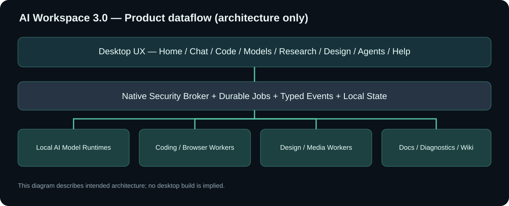

# Encyclopedia Navigation

[Master Plan v3](MASTER_PLAN_V3.md) | [Phase Contracts](PHASE_SPECS.md) | [22 Module Dossiers](modules/README.md) | [Research Bank](research/OPTIONS_BANK_V3.csv) | [Design Candidates](research/DESIGN_COMPETITOR_MATRIX.csv) | [Screen Inventory](ui/SCREEN_INVENTORY.csv) | [Option Catalog](ui/OPTION_CATALOG.csv) | [In-App Help Drafts](help/README.md) | [Wiki Source](wiki/README.md) | [Screenshot Manifest](screenshots/MANIFEST.json) | [Error GitHub Issue Workflow](operations/ISSUE_AUTOMATION.md) | [Pre-Dev](quality/PRE_DEVELOPMENT_CHECKLIST.md) | [Quality Gates](quality/RELEASE_GATES.md) | [Agents](../AGENTS.md).

Pages are standalone and linked so an AI can load only current module and its contracts. At every phase transition remote GitHub truth must be verified and memory updated.

## v3.1 extensions

[Data Vault + backup](operations/DATA_VAULT_BACKUP_RECOVERY.md) · [Relocatable Storage](operations/STORAGE_DOWNLOADS_RELOCATION.md) · [Automated Releases and Updates](operations/AUTO_RELEASE_AND_UPDATES.md) · [P00–P12 integration](PHASE_SPECS.md).

## v3.2 — changelog and traceability

[Consolidated v3.2 Master Plan](MASTER_PLAN_V3_2.md) · [M26 — Changelog and Change Intelligence](modules/M26.md) · [Change Events and Release Notes Contract](operations/CHANGE_INTELLIGENCE_CHANGELOG.md) · [M26 Help](help/articles/M26.md) · [M26 Wiki draft](wiki/pages/M26.md) · [Product Changelog](../CHANGELOG.md) · [Specification Changelog](PLANNING_CHANGELOG.md) · [Change Record Schema](changelog/schema/change-record.schema.json).

[Changelog tooling comparison](research/CHANGELOG_TOOL_COMPARISON.csv) · [Event envelope schema](changelog/schema/change-event.schema.json).
