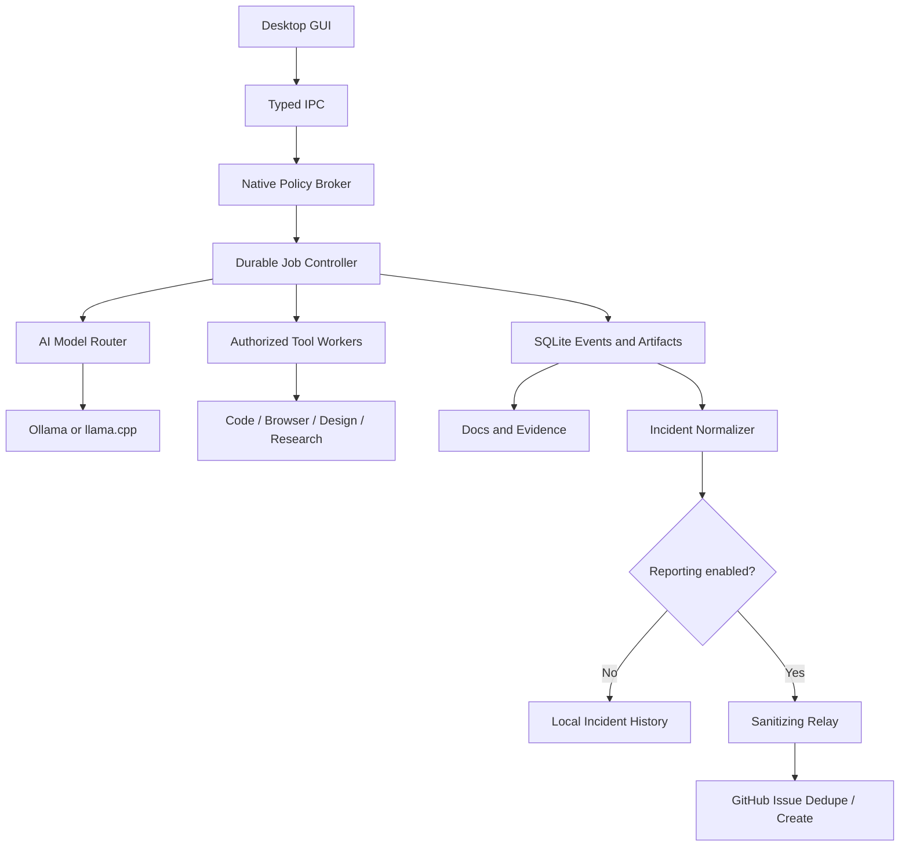

# End-to-end Dataflow Contracts

## System data graph



## Event envelope

```json
{"schema_version":1,"event_id":"ulid","trace_id":"ulid","project_id":"opaque","module_id":"Mxx","phase_id":"Pxx","type":"module.event","sequence":1,"occurred_at":"UTC ISO8601","payload":{"typed":"module-specific"},"origin":"UI|worker|runtime","policy_decision_id":"optional"}
```

Safety: origin metadata is not permission. Native broker verifies actual process identity, scope and operation. State changes are replayable; external side effects need idempotency safeguards. Batch UI events with backpressure, separate render/inference workers. Every module dossier lists its event vocabulary.
