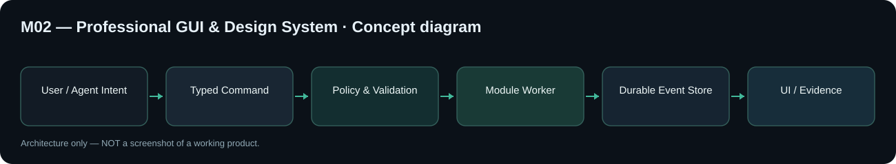

# Professional GUI & Design System — P02 preview guide

**Module:** [M02 module contract](../../modules/M02.md)  
**Status:** Source-verified P02 preview reference. Not a release manual; final manifest PNGs and full options/states remain pending.  
**In-app Help:** F1 opens the bundled offline Help Center. A full `help://m02` option deep-link route is not yet wired.  
**GitHub Wiki source:** [Wiki guide](../../wiki/pages/M02.md)  
**Concept diagram:** 

## What this module is for

Production polished shared shell and component system, frozen before feature modules. Use this module when you need: tokens; theme; navigation; command palette; accessibility; density. This page becomes release-ready only when the linked screenshots are generated from the real running app and manually/automatically validated for content and accessibility.

## Quick start — implemented P02 preview only

1. Launch the real Windows desktop executable (a browser build is not native service proof). Open **Workbench** with Ctrl+5, **Components** with Ctrl+6, or **Preferences** with Ctrl+2.
2. In **Components**, use Tab to focus Primary/Secondary examples, Enter or Space to select one and observe the selected-state feedback; the Unavailable button stays disabled. Enter text in the sample field independently; it is not overwritten by action selection.
3. In **Workbench**, use Left/Right arrows to change focused tabs. The Layout controls tab offers a 25–65% session-only split preview with 5-point steps.
4. In **Preferences**, choose the system/dark/light appearance and comfortable/compact navigation density. Changes apply immediately but **are not saved to disk**, and restarting resets them.
5. Press **Ctrl+Shift+P** for the navigation-only command palette; filter, use Up/Down, press Enter to open a view, or Esc to cancel. Press F1 for bundled offline Help.
6. The project creation, real canvas, backup restore, arbitrary storage relocation operations are **not implemented**. Compact properties spacing now works for illustrative rows only, not a real project inspector. Do not claim they succeeded or produced a saved artifact.

**Screenshot/provenance boundary:** Real Windows candidate captures exist for Workbench, command palette, Components, Preferences, keyboard focus, gallery selected state and narrow 898px viewport. Their source/build SHAs and SHA256 are checked in GitHub Actions. They remain **CI candidates**, not completed screen/option PNGs under `docs/screenshots/MANIFEST.json`. The [P02 visual audit](../../evidence/P02_T02_FIRST_REAL_UI_SLICE.md) records specific review outcomes and limitations.

## P02-T03 — Adaptive navigation and structured workspace layout

**Scope:** The shared Windows desktop shell provides a navigation rail, semantic page breadcrumb, main content area, footer and a keyboard-accessible Workbench with three named panels. This is a foundation UI, **not a real project editor**.

**Automatic layout:** At window widths **1000px or less**, the navigation switches to a **78px icon rail** so the content remains readable near Tauri's 900px native minimum width. At wider sizes, the rail expands with section headings, page titles and current Ctrl+1–6 shortcut labels. Resizing across the breakpoint updates the mode immediately. The application never writes this choice to disk or cloud.

**Manual toggle:** Use the rail's **Expand navigation / Collapse navigation** button or **Alt+N** when the app owns keyboard focus. The button announces its current action and expanded state. Alt+N is intentionally ignored while typing in an input, textarea or select and when the command palette is open. The navigation controls remain keyboard reachable in both modes; each icon button still has a complete accessible name, active-page indication, section grouping and dynamic shortcut label.

**Workspace structure:** The top breadcrumb identifies the current view and the central Workbench offers Runtime status, Layout controls and Keyboard guide. In Layout controls, the **Left pane width** slider defaults to 40%, accepts 25–65% in 5-point increments, and resizes two *illustrative*, named navigation/content preview regions. The pane contents never create or persist user data.

**Native evidence:** `P02-T03-RAIL-COLLAPSED`, `P02-T03-RAIL-EXPANDED` and `P02-T03-RAIL-RESTORED` are real Windows Tauri **CI candidate** captures at the narrow viewport. Their source/build SHA and PNG hashes **passed Windows CI at commit `b8073122`** and their collapsed, expanded and restored states were [independently visually reviewed](../../screenshots/M02/P02-T03-navigation.review.json). They are not final M02 screen or option PNG approvals; all 15 final M02 manifest entries remain separately gated.

## P02-T02.06 — Gallery interaction state examples

Open **Components** with Ctrl+6. The **Primary action** and **Secondary** buttons are working *local UI examples*: choose one to show its pressed/selected styling and hear a screen-reader status announcement. Hover only affects enabled controls; the **Unavailable** button is intentionally disabled and cannot perform a task. The **Ready**, **Pending**, **Offline** and **Error example** chips are static design examples, **not actual system-health indicators**.

Type a sample value into the adjacent text field, then select either action. **Button selection must not overwrite the typed value.** Both values are transient React state and are discarded when the Components screen is unmounted. No workspace file is written, no network request is sent, and no disabled control can be activated. Use Tab to reach active controls and Space/Enter to activate a selected-state example. The selected-state confirmation is a polite status message and the active button exposes `aria-pressed`.

**Evidence:** P02 native candidate `P02-T02-06` shows an interacted gallery; unit/source and real desktop acceptance must pass before treating the example as verified. Hover remains a visual behavior, not a claim of a backend action. The candidate screenshot remains under `docs/screenshots/_ci/M02/` until independent visual review and repository acceptance.

## P02-T02.07 — Responsive component foundations

The Windows Tauri desktop window is resizable down to **900px** (native minimum). At narrow window widths up to 950px, the Component Gallery switches from two columns to one and the metrics use a wrapping grid; badges and state descriptions wrap without horizontal clipping. The Workbench (Ctrl+5) uses a bounded left-pane percentage, **25–65%** in 5-point increments, with `minmax(0, ...)` columns so the content can shrink and wrap instead of forcing a wide panel. The split preview is local session-only UI: no real project canvas is created and there is no persistence.

To verify: resize the native desktop window toward its minimum; inspect Component Gallery headings, metrics, buttons, status labels and text input without any sideways scroll. In the Workbench, navigate to **Layout controls** with Right Arrow while a tab is focused, and use the **Left pane width** slider with arrow keys. The accessible slider value announces its percentage. At narrow sizes, text should wrap and cards should remain keyboard reachable.

**Evidence:** Real Windows screenshot candidates `P02-T02-07` and `P02-T02-07-continued` use measured native DWM frame bounds; screenshots are candidates pending visual review. The 720px browser preview is not proof of native desktop behavior.

## M02 option reference — implemented behavior versus planned controls

**Legend:** "Implemented (session)" means the local UI works but makes no persistent or backend changes. "Preview only" means the behavior is fixed/nonconfigurable. "Not implemented" means no interactive option is available; its screenshot stays pending. The option IDs are stable contract IDs, not proof that every option is functional.

| Option | Current control and default | Availability | Privacy/storage |
| --- | --- | --- | --- |
| M02-OPT-01 | Preferences → Navigation density; Comfortable (default) / Compact | Implemented (session) | No disk/account persistence |
| M02-OPT-02 | Preferences → Appearance; Follow system (default) / Dark / Light | Implemented (session) | Follows OS color preference or explicit session selection |
| M02-OPT-03 | Workbench → Layout controls → Compact on/off; default Off (comfortable) | Implemented (session-only preview) | Illustrative property rows; no project editing, disk or account storage |
| M02-OPT-04 | Workbench → Keyboard guide → Ctrl+1…6 mapping dropdowns; default 1–6 | Implemented (session only) | Collision-safe swaps and reset; reserved F1/ Ctrl+Shift+P never remap |
| M02-OPT-05 | Command palette search, maximum 100 characters | Implemented (session) | Local allowlisted navigation search only |
| M02-OPT-06 | Workbench → Layout controls → Left pane width; 40% default, 25–65%, step 5 | Implemented (session) | Visual layout preview; no project document or canvas |
| M02-OPT-07 | Visible keyboard focus outline; 2px plus 3px offset | Preview only (always on keyboard focus) | No toggle or preference written |
| M02-OPT-08 | OS reduced-motion preference | Preview only (automatic CSS) | No in-app reduce-motion switch or storage |

### M02-OPT-01 — Navigation density

**Purpose and workflow:** Ctrl+2 → Navigation density → select **Comfortable** (default) or **Compact**. The sidebar and several list rows use reduced spacing with Compact. Use Tab to focus the native select and Up/Down to change values; switching to Comfortable reverses the layout. No validation error or remote permission is involved for these two defined choices.

**Limit:** React state lasts only for the current running window. No save, sync, or durable preference exists. A fresh launch reverts to Comfortable. **Screenshot:** `../../screenshots/M02/M02-OPT-01.png` — **PENDING final per-option native capture and review**; Preferences screen candidate `M02-S06` is supporting context, not a substitute.

### M02-OPT-02 — Light/Dark/System theme

**Purpose and workflow:** Ctrl+2 → Appearance → **Follow system** (default), **Dark** or **Light**. The system setting tracks Windows' active light/dark preference while this app is running. The fixed choices override it until the application is restarted. Tab to the select and use arrow keys; revert by choosing Follow system.

**Contrast:** Semantic dark/light tokens have automated WCAG AA small-label and focus-ring checks. This does not replace visual validation for all color combinations. **Storage:** session-only; neither Windows nor account preferences are changed. **Native candidate evidence:** explicit Light and Dark Preferences views were captured and visually reviewed in real Tauri at source SHA `e22d51d` ([scoped review](../../screenshots/M02/T02-12-appearance-keyboard.review.json)); these two CI candidates demonstrate theme switching but do not cover system-preference scenarios. **Final option screenshot:** `../../screenshots/M02/M02-OPT-02.png` — **PENDING** final manifest review and per-state proof.

### M02-OPT-03 — Compact properties panel

**Status:** **Implemented as a session-only foundation preview.** Open Workbench (Ctrl+5) → select the **Layout controls** tab by keyboard arrows or pointer → locate **Properties panel density**. The **Compact off** button is the default (comfortable rows). Press Enter or Space to enable **Compact on**: `aria-pressed` updates and sample Selection, Mode and Storage rows become denser. Press again to restore Comfortable spacing. An accessible status message announces the selected density.

**Limit:** This preview is distinct from Preferences → Navigation density. It does **not** edit actual project/layer properties, and it does not create a live property inspector or save a setting; the three rows are illustrative text and React local state resets when the Workbench view unmounts. At narrow desktop widths the control and rows wrap without requiring horizontal scrolling. A real project editor is unavailable.

**Screenshot:** `../../screenshots/M02/M02-OPT-03.png` — **PENDING source-SHA-bound, visually reviewed native control-state capture**. Working source and automated tests alone do not satisfy this final option screenshot requirement.

### M02-OPT-04 — Global keyboard shortcut mapping

**Status:** **Implemented for session-only navigation controls.** Open Workbench (Ctrl+5) → **Keyboard guide** (use Right Arrow/End from a focused tab). Six labeled selects let you assign Ctrl+1 through Ctrl+6 to Overview, Preferences, Recovery, Diagnostics, Workbench or Components. Each shortcut remains unique: assigning an occupied key **swaps both destinations** instead of losing either command. The sidebar and command palette update to display current keys. Select **Restore default shortcuts** to return to Overview=1, Preferences=2, Recovery=3, Diagnostics=4, Workbench=5, Components=6.

**Constraints and recovery:** F1 Help and Ctrl+Shift+P command palette are **reserved**, so they cannot be remapped. Changes remain in local React state, not disk, account, native hotkey manager or cloud; restart resets defaults. Global navigation shortcuts are suppressed while typing in an input or select and while the command-palette dialog owns keyboard focus, to avoid unexpected navigation. If an assignment is confusing, navigate via the sidebar or palette and use **Restore default shortcuts**. This is not an OS-level/global-across-applications key hook.

**Native preview evidence:** [Real Windows default and swapped shortcut states](../../screenshots/M02/M02-OPT-04.review.json) were independently inspected at source SHA `caf45f8`; Overview Ctrl+2 and Preferences Ctrl+1 are visibly synchronized after a swap. The artifact remains a CI candidate. **Final screenshot:** `../../screenshots/M02/M02-OPT-04.png` — **PENDING** manifest approval; scoped candidate review is not a release-ready option screenshot.

### M02-OPT-05 — Command palette search

**Purpose and workflow:** Ctrl+Shift+P → type up to **100 characters** → select one of the fixed app views by Up/Down then Enter, or click an item. Press Esc or the Close button to cancel. Searches are local, bounded, and only navigate among the allowlisted views; no commands execute arbitrary scripts or reach the network. Empty results show a safe "No matching commands" state. Focus returns to its opener on cancellation when still connected, or to the main content surface.

**Scope:** Session interaction only, no history or stored results. **Screenshot:** `../../screenshots/M02/M02-OPT-05.png` — **PENDING** option-state capture. `M02-S04` is a source-SHA-bound real desktop command-palette candidate and must not automatically satisfy the option screenshot gate.

### M02-OPT-06 — Split pane resizing

**Purpose and workflow:** Ctrl+5 → keyboard focus on tablist → Right Arrow to **Layout controls** → Tab to slider `Left pane width`. Default **40%**; valid range **25–65%** in steps of **5**. Use arrow keys for stepwise changes. The adjacent output announces the percentage; two preview panes visually reflow and wrap on narrow native windows.

**Limit:** No real project layout, no drag-resize persistence and no saved workspace. Slider changes only the current React session preview. **Screenshot:** `../../screenshots/M02/M02-OPT-06.png` — **PENDING** option-specific real native state capture.

### M02-OPT-07 — Focus visibility

**Purpose:** A keyboard user should always see which workbench control or panel has focus. Open Workbench (Ctrl+5), Tab to a focused tab, then Tab into the active panel. Shift+Tab reverses direction; Left/Right arrows move among tab buttons.

**Built-in behavior:** No toggle. A keyboard-focused tabpanel shows a 2px outline using the light/dark `--outline` token and a 3px offset. The contrast token is tested against five semantic surfaces at at least 3:1. If the ring is not visible, use Tab/Shift+Tab to navigate and report the focused control to the developer; no remote telemetry is sent.

**Evidence:** `M02-OPT-07` native Windows focus candidate was independently inspected with its SHA256 bound to the code. The final `../../screenshots/M02/M02-OPT-07.png` remains **PENDING** in the manifest until the versioned PNG and all module gates are accepted.

### M02-OPT-08 — Reduce motion

**Built-in behavior:** The interface's `prefers-reduced-motion: reduce` CSS disables animated motion/transitions if Windows reports reduced motion. This is automatic; the application has **no independent Reduce motion switch**, no saved setting, and does not change the operating system preference.

**Workflow:** Use Windows accessibility settings to enable reduced motion, then reopen or inspect the app; use OS settings to revert. **Screenshot:** `../../screenshots/M02/M02-OPT-08.png` — **PENDING** verified native OS-preference scenario.

## Troubleshooting, accessibility and privacy

- **Navigation shortcut does not respond:** first exit the command-palette modal with Esc; typing inside an input/select intentionally suppresses most global shortcuts. Use the sidebar or Ctrl+Shift+P when no text field has focus.
- **Palette has no matches:** clear the bounded search text or search one of "Overview", "Workbench", "Components", "Preferences" or "Help". No remote provider is consulted.
- **A control is disabled:** workspace creation, canvas, storage relocation and recovery are not configured. Their disabled state is intentional, not a network outage that Retry can fix.
- **Focus outline missing:** use Tab to reach the control; pointer focus does not always trigger `:focus-visible`. Keyboard focus can be inspected in the native Windows Tauri app.
- **Theme/density resets:** intended session-only state. No preference persistence exists in P02.
- **Native desktop does not start:** use the verified Windows executable. Browser preview cannot prove the native IPC handshake, and Diagnostics is only a capability summary, **not** a live incident reader or automatic reporting system.
- **Privacy:** Gallery typed sample and selection are transient React state; no project document or cloud upload is created. The bundled offline Help Center does not fetch remote content. Screenshot CI uses disposable fixtures without real user files.

**Verification boundary:** Contract tests, candidate Windows screenshots and source-controlled Wiki pages are evidence of the P02 slice only. Full accessibility walkthrough, every option screenshot, final Help bundle sync, remote Wiki publication and production release remain separate gates.

## Related articles and support

[All help topics](../README.md) · [Wiki index](../../wiki/README.md) · [Security & reporting](../../operations/ISSUE_AUTOMATION.md) · [Option catalog](../../ui/OPTION_CATALOG.csv).

**Release documentation gate:** This is a tested-source preview reference, **not a released user guide**. Every required native screenshot/option, final manifest entry, offline Help bundle and remote Wiki mapping must be independently accepted before release.

## P02 T05 — System preference feedback, reset, and boundaries

Open Preferences (Ctrl+2). A live status panel announces the effective Dark/Light theme, whether it comes from the operating system or a manual override, navigation density and whether Windows currently requests reduced motion. The two media preferences are observed while the application window is open. Follow system and Comfortable are the initial values. Restore interface defaults resets these two session controls; the button is disabled at defaults. No OS setting, project file, account or network request is altered. Use Tab, arrows and Space/Enter to control and revert the options.

**Test coverage:** TypeScript compile, Node UI model and Python source contracts, followed by native Windows preference-change and keyboard verification. Final screen M02-S06.png and option images M02-OPT-01.png, M02-OPT-02.png and M02-OPT-08.png remain pending source-SHA-bound capture and independent review; OS motion cannot be declared tested from static CSS alone.

## P02 T06 — Complete illustrative component state explorer

Open Components (Ctrl+6), then Empty, loading and recovery states. Five working controls switch among Ready, Loading, Empty, Error and Offline, each exposing aria-pressed and an accessible live region containing the sample title, details and safe recovery guidance. Show ready example resets the preview and is disabled at Ready. Nothing is downloaded, saved, waited on or repaired; these are explicitly illustrative states, not actual native service status. The existing gallery input value stays independent of state selection.

Open Workbench (Ctrl+5), Layout controls to adjust the 25–65 percent pane split. Reset pane split restores the 40/60 layout; the button is disabled at 40 percent. The live status describes both percentages. This is a reversible session preview, not a persistent project editor. Real Windows native narrow-layout screenshots, keyboard focus, a11y and all-state review are still required for T06 signoff.

### P02 T05/T06 actual desktop machine candidates

The Windows native screenshot flow now additionally creates `P02-T06-GALLERY-READY`, `P02-T06-GALLERY-OFFLINE` and `P02-T05-PREFERENCES-LIVE`, captured with keyboard interactions from the real Tauri executable. The verifier hashes every frame and refuses identical Ready/Offline states or Gallery/Preferences view changes. These are not final `M02-Sxx` or `M02-OPT-xx` manifest assets. Visual review and Windows CI success must be recorded against exact source SHA before using them as scoped evidence.

## In-app M02 option directory

Help → **Option reference** lists all `M02-OPT-01` through `M02-OPT-08` in the running desktop bundle with defaults, interactions, limitations and undo/recovery. Search them locally or validate a strict internal route, e.g. `help://option/M02-OPT-06`. No OS URI handler or network opening is implied. Option IDs are versioned and mapped to real bundled Help topics. Some actions remain illustrative and session-only. Final native option screenshots are separate acceptance obligations.

**T06 native state matrix:** Windows CI now targets all five Gallery state examples via keyboard and asserts distinct source-SHA-bound real PNG hashes. This is not real backend service-state evidence or final screenshot manifest approval; visual and assistive-technology review remains pending.

## Unified command palette and offline Help discovery (P02 source)
Press Ctrl+Shift+P and type a screen, help topic or M02/M19 option ID. The same keyboard palette searches seven available views, twelve local Help articles and sixteen documented options. Use Arrow Up/Down and Enter; Escape restores opener focus. View shortcuts follow the current session remapping. Empty search shows seven navigation commands; typed results are limited to twenty. Choosing an article opens the existing offline reader with clear filters, and choosing an option opens the exact option reference. Nothing is uploaded, persisted, executed as a shell command or fetched remotely.

**Status:** Source feature in Draft P02 PR #12. Complete Windows native CI, independent screenshots and assistive-technology testing are still required; this section does not assert module or phase acceptance.
