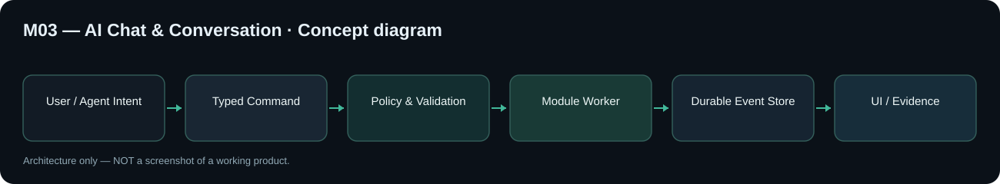

# AI Chat & Conversation — complete user guide

**Module:** [M03 module contract](../../modules/M03.md)  
**Status:** P03 development guide: T01–T09 scoped acceptance; T10–T14 candidate verification and T15 screenshot/publication pending.
**In-app Help route (planned):** `help://m03`  
**GitHub Wiki source:** [Wiki guide](../../wiki/pages/M03.md)  
**Concept diagram:** 

## What this module is for

Fast streaming local conversation with files, tools and durable history. Use this module when you need: threads; prompts; attachments; streaming; context; tool review. This page becomes release-ready only when the linked screenshots are generated from the real running app and manually/automatically validated for content and accessibility.

## First-time workflow

1. Open the relevant module from the desktop navigation or global command palette.
2. Check the visible status indicator, permissions and prerequisites; never assume all optional workers are installed.
3. Select the project/workspace/context the module should operate on.
4. Configure the relevant option from the reference below, noting default and supported values.
5. Execute a small real task and review the actual artifact/status/log.
6. If operation fails, open Diagnostics with its local incident ID and follow the troubleshooting section.
7. Return to contextual Help using `F1` or the documented help action (pending implementation verification).

## Each user option: purpose, behavior and screenshot contract

### M03-OPT-01 — Per-thread model choice

- **Purpose:** Access the per-thread model choice workflow in AI Chat & Conversation; this option must solve a specific user task, not be decorative.
- **Preconditions:** Active project/module, compatible dependencies and granted scope; if absent, show a remediation action.
- **Control contract:** Searchable native `<select>` populated only from the fixed-loopback Ollama installed-model inventory. No default; the user chooses per thread. Model names are bounded and the native service rejects missing/uninstalled entries.
- **Expected behavior:** Selection persists in the local native vault for this conversation and survives restart. Refresh local models reconciles removal without silently substituting another model. Send and Retry require a currently available installed model; if the saved choice is unavailable, refresh the inventory or choose another installed model. Save message remains independent of model availability.
- **Failure behavior:** Display a stable error code, actionable recovery, diagnostics link and preserve prior valid state.
- **Accessibility:** Keyboard operation, visible focus and complete accessible label.
- **Actual screenshot:** `../../screenshots/M03/M03-OPT-01.png` — **PENDING** until the working module is built; a real annotated image with alt text is mandatory for final acceptance.
- **Automated evidence:** `M03-OPT-01` visual/component/E2E test and success/failure log (required in implementation PR).

### M03-OPT-02 — Streaming and stop

- **Purpose:** Access the streaming and stop workflow in AI Chat & Conversation; this option must solve a specific user task, not be decorative.
- **Preconditions:** Active project/module, compatible dependencies and granted scope; if absent, show a remediation action.
- **Control contract:** Send, Stop and Retry turn are native buttons. Send requires a selected installed model; Stop is enabled only while a turn is active; Retry is enabled only after a non-complete attempt.
- **Expected behavior:** The user message commits before inference. Ordered deltas are transient; the terminal assistant response is appended only after its database commit. Stop requests cancellation of the active loopback turn and a non-empty partial response is marked cancelled. A rejected Stop request is not an acknowledgement. Interruptible transport has scoped native verification; do not assume the model process stops instantly. Retry creates a new attempt ID.
- **Failure behavior:** Display a stable error code, actionable recovery, diagnostics link and preserve prior valid state.
- **Accessibility:** Keyboard operation, visible focus and complete accessible label.
- **Actual screenshot:** `../../screenshots/M03/M03-OPT-02.png` — **PENDING** until the working module is built; a real annotated image with alt text is mandatory for final acceptance.
- **Automated evidence:** `M03-OPT-02` visual/component/E2E test and success/failure log (required in implementation PR).

### M03-OPT-03 — Context budget inspector

- **Purpose:** Access the context budget inspector workflow in AI Chat & Conversation; this option must solve a specific user task, not be decorative.
- **Preconditions:** Active project/module, compatible dependencies and granted scope; if absent, show a remediation action.
- **Control contract:** Per-thread selector values are 512, 1024, 2048, 4096, 8192, 16384 or 32768 tokens. Inspect context shows estimated usage (including system and output reserve), included messages and omitted messages, including the current draft. The byte-based estimate is conservative but not an exact model tokenizer count; shorten the draft or choose a larger supported budget when needed.
- **Expected behavior:** Native assembly includes only the same conversation's newest complete messages in chronological order, excludes failed/cancelled output and refuses a latest prompt that cannot fit. No silent cross-thread context. Editing or clearing the draft invalidates the prior estimate; inspect again to see the current budget.
- **Failure behavior:** Display a stable error code, actionable recovery, diagnostics link and preserve prior valid state.
- **Accessibility:** Keyboard operation, visible focus and complete accessible label.
- **Actual screenshot:** `../../screenshots/M03/M03-OPT-03.png` — **PENDING** until the working module is built; a real annotated image with alt text is mandatory for final acceptance.
- **Automated evidence:** `M03-OPT-03` visual/component/E2E test and success/failure log (required in implementation PR).

### M03-OPT-04 — Attach local files

- **Purpose:** Access the attach local files workflow in AI Chat & Conversation; this option must solve a specific user task, not be decorative.
- **Preconditions:** Active project/module, compatible dependencies and granted scope; if absent, show a remediation action.
- **Control contract:** Choose Attach local files; remove unwanted selections, enter message text, and choose Save message. Draft selection is session-only; Send is disabled while draft files are present.
- **Expected behavior:** The local vault verifies content and commits attachment links with the message. Retry the same request if acknowledgement is uncertain. Saved metadata does not open a file or grant model access.
- **Failure behavior:** Display a stable error code, actionable recovery, diagnostics link and preserve prior valid state.
- **Accessibility:** Keyboard operation, visible focus and complete accessible label.
- **Actual screenshot:** `../../screenshots/M03/M03-OPT-04.png` — **PENDING** until the working module is built; a real annotated image with alt text is mandatory for final acceptance.
- **Automated evidence:** `M03-OPT-04` visual/component/E2E test and success/failure log (required in implementation PR).

### M03-OPT-05 — Generate artifact

- **Purpose:** Access the generate artifact workflow in AI Chat & Conversation; this option must solve a specific user task, not be decorative.
- **Preconditions:** Active project/module, compatible dependencies and granted scope; if absent, show a remediation action.
- **Control contract:** Choose Generate text artifact on a complete saved assistant response; use Preview text artifact on the receipt.
- **Expected behavior:** Exact UTF-8 text is verified and saved as assistant-response.txt. Repeat creation verifies the same receipt, not a duplicate; failed/cancelled output cannot be materialized.
- **Failure behavior:** Display a stable error code, actionable recovery, diagnostics link and preserve prior valid state.
- **Accessibility:** Keyboard operation, visible focus and complete accessible label.
- **Actual screenshot:** `../../screenshots/M03/M03-OPT-05.png` — **PENDING** until the working module is built; a real annotated image with alt text is mandatory for final acceptance.
- **Automated evidence:** `M03-OPT-05` visual/component/E2E test and success/failure log (required in implementation PR).

### M03-OPT-06 — Retry last turn

- **Purpose:** Access the retry last turn workflow in AI Chat & Conversation; this option must solve a specific user task, not be decorative.
- **Preconditions:** Active project/module, compatible dependencies and granted scope; if absent, show a remediation action.
- **Control contract:** Choose Retry turn for the latest eligible interrupted or failed turn; reopen and load more history if needed. Clear unsent drafts before retrying.
- **Expected behavior:** Original committed user message remains intact; each retry uses new attempt/assistant IDs. A zero-output terminal notice survives restart and can be explicitly retried. No automatic retry.
- **Failure behavior:** Display a stable error code, actionable recovery, diagnostics link and preserve prior valid state.
- **Accessibility:** Keyboard operation, visible focus and complete accessible label.
- **Actual screenshot:** `../../screenshots/M03/M03-OPT-06.png` — **PENDING** until the working module is built; a real annotated image with alt text is mandatory for final acceptance.
- **Automated evidence:** `M03-OPT-06` visual/component/E2E test and success/failure log (required in implementation PR).

### M03-OPT-07 — Export full conversation

- **Purpose:** Access the export full conversation workflow in AI Chat & Conversation; this option must solve a specific user task, not be decorative.
- **Preconditions:** Active project/module, compatible dependencies and granted scope; if absent, show a remediation action.
- **Control contract:** Candidate: select Conversation export, confirm the plaintext warning and local destination, then Export full conversation.
- **Expected behavior:** Complete selected conversation and linked verified bytes, up to 4096 messages and 32 MiB; fails rather than truncates. Receipt identifies path and SHA-256. No overwrite, encryption or Save As picker.
- **Failure behavior:** Display a stable error code, actionable recovery, diagnostics link and preserve prior valid state.
- **Accessibility:** Keyboard operation, visible focus and complete accessible label.
- **Actual screenshot:** `../../screenshots/M03/M03-OPT-07.png` — **PENDING** until the working module is built; a real annotated image with alt text is mandatory for final acceptance.
- **Automated evidence:** `M03-OPT-07` visual/component/E2E test and success/failure log (required in implementation PR).

### M03-OPT-08 — Tool call details

- **Purpose:** Access the tool call details workflow in AI Chat & Conversation; this option must solve a specific user task, not be decorative.
- **Preconditions:** Active project/module, compatible dependencies and granted scope; if absent, show a remediation action.
- **Control contract:** Candidate: choose Review text artifact tool or Review attachment tool. Inspect exact operation, target and digest; approve or deny within two minutes; Refresh tool trace reads decisions.
- **Expected behavior:** One-use approval is scope- and revision-bound; denial executes nothing. Historical approval cannot authorize a new action. Model-origin structured calls remain blocked; native acceptance pending.
- **Failure behavior:** Display a stable error code, actionable recovery, diagnostics link and preserve prior valid state.
- **Accessibility:** Keyboard operation, visible focus and complete accessible label.
- **Actual screenshot:** `../../screenshots/M03/M03-OPT-08.png` — **PENDING** until the working module is built; a real annotated image with alt text is mandatory for final acceptance.
- **Automated evidence:** `M03-OPT-08` visual/component/E2E test and success/failure log (required in implementation PR).

## Troubleshooting and privacy

If Ollama is unavailable, start or repair the local runtime outside Zynoa and choose Refresh local models. A removed model must be selected again; Zynoa never downloads or substitutes one in this phase. Context overflow requires a larger supported budget or a shorter new message. Interrupted turns leave committed user history intact. Raw prompts, output, paths and credentials are never attached to public tickets.

## Related articles and support

[All help topics](../README.md) · [Wiki index](../../wiki/README.md) · [Security & reporting](../../operations/ISSUE_AUTOMATION.md) · [Option catalog](../../ui/OPTION_CATALOG.csv).

**Release documentation gate:** Pending screenshots and unverified controls cannot ship as completed help. This document is a content specification until actual implementation replaces placeholders with tested instructions.

## P03 attachment validation candidate (not yet an enabled workflow)

Historical heading retained for existing links. The attachment, retry and artifact workflows now have scoped acceptance; follow options 04–06 above. Check managed files is a read-only bounded inventory; it never deletes, moves or opens data. Unreferenced files and stages may be the only remaining copy. Tool review and full conversation export remain development candidates; see options 07–08. V4 upgrades require verified pre-upgrade snapshot; downgrade is unsupported. Final screenshots and hosted Wiki verification remain pending.
