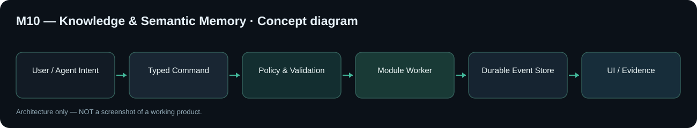

# Knowledge & Semantic Memory — complete user guide

**Module:** [M10 module contract](../../modules/M10.md)  
**Status:** Planned content; not yet a release user manual.  
**In-app Help route (planned):** `help://m10`  
**GitHub Wiki source:** [Wiki guide](../../wiki/pages/M10.md)  
**Concept diagram:** 

## What this module is for

Layered long-term memory with authoritative project records and retrieval. Use this module when you need: documents; indexing; embeddings; context; retention. This page becomes release-ready only when the linked screenshots are generated from the real running app and manually/automatically validated for content and accessibility.

## First-time workflow

1. Open the relevant module from the desktop navigation or global command palette.
2. Check the visible status indicator, permissions and prerequisites; never assume all optional workers are installed.
3. Select the project/workspace/context the module should operate on.
4. Configure the relevant option from the reference below, noting default and supported values.
5. Execute a small real task and review the actual artifact/status/log.
6. If operation fails, open Diagnostics with its local incident ID and follow the troubleshooting section.
7. Return to contextual Help using `F1` or the documented help action (pending implementation verification).

## Each user option: purpose, behavior and screenshot contract

### M10-OPT-01 — Choose index folders

- **Purpose:** Access the choose index folders workflow in Knowledge & Semantic Memory; this option must solve a specific user task, not be decorative.
- **Preconditions:** Active project/module, compatible dependencies and granted scope; if absent, show a remediation action.
- **Control contract:** Final control type/default/allowed values MUST be recorded after P07 UI spike; no guessed setting values are presented here as implemented.
- **Expected behavior:** Persist relevant settings and show the verified result or progress with cancel/retry where supported.
- **Failure behavior:** Display a stable error code, actionable recovery, diagnostics link and preserve prior valid state.
- **Accessibility:** Keyboard operation, visible focus and complete accessible label.
- **Actual screenshot:** `../../screenshots/M10/M10-OPT-01.png` — **PENDING** until the working module is built; a real annotated image with alt text is mandatory for final acceptance.
- **Automated evidence:** `M10-OPT-01` visual/component/E2E test and success/failure log (required in implementation PR).

### M10-OPT-02 — Rebuild index

- **Purpose:** Access the rebuild index workflow in Knowledge & Semantic Memory; this option must solve a specific user task, not be decorative.
- **Preconditions:** Active project/module, compatible dependencies and granted scope; if absent, show a remediation action.
- **Control contract:** Final control type/default/allowed values MUST be recorded after P07 UI spike; no guessed setting values are presented here as implemented.
- **Expected behavior:** Persist relevant settings and show the verified result or progress with cancel/retry where supported.
- **Failure behavior:** Display a stable error code, actionable recovery, diagnostics link and preserve prior valid state.
- **Accessibility:** Keyboard operation, visible focus and complete accessible label.
- **Actual screenshot:** `../../screenshots/M10/M10-OPT-02.png` — **PENDING** until the working module is built; a real annotated image with alt text is mandatory for final acceptance.
- **Automated evidence:** `M10-OPT-02` visual/component/E2E test and success/failure log (required in implementation PR).

### M10-OPT-03 — Recall source

- **Purpose:** Access the recall source workflow in Knowledge & Semantic Memory; this option must solve a specific user task, not be decorative.
- **Preconditions:** Active project/module, compatible dependencies and granted scope; if absent, show a remediation action.
- **Control contract:** Final control type/default/allowed values MUST be recorded after P07 UI spike; no guessed setting values are presented here as implemented.
- **Expected behavior:** Persist relevant settings and show the verified result or progress with cancel/retry where supported.
- **Failure behavior:** Display a stable error code, actionable recovery, diagnostics link and preserve prior valid state.
- **Accessibility:** Keyboard operation, visible focus and complete accessible label.
- **Actual screenshot:** `../../screenshots/M10/M10-OPT-03.png` — **PENDING** until the working module is built; a real annotated image with alt text is mandatory for final acceptance.
- **Automated evidence:** `M10-OPT-03` visual/component/E2E test and success/failure log (required in implementation PR).

### M10-OPT-04 — Forget indexed item

- **Purpose:** Access the forget indexed item workflow in Knowledge & Semantic Memory; this option must solve a specific user task, not be decorative.
- **Preconditions:** Active project/module, compatible dependencies and granted scope; if absent, show a remediation action.
- **Control contract:** Final control type/default/allowed values MUST be recorded after P07 UI spike; no guessed setting values are presented here as implemented.
- **Expected behavior:** Persist relevant settings and show the verified result or progress with cancel/retry where supported.
- **Failure behavior:** Display a stable error code, actionable recovery, diagnostics link and preserve prior valid state.
- **Accessibility:** Keyboard operation, visible focus and complete accessible label.
- **Actual screenshot:** `../../screenshots/M10/M10-OPT-04.png` — **PENDING** until the working module is built; a real annotated image with alt text is mandatory for final acceptance.
- **Automated evidence:** `M10-OPT-04` visual/component/E2E test and success/failure log (required in implementation PR).

### M10-OPT-05 — Data retention

- **Purpose:** Access the data retention workflow in Knowledge & Semantic Memory; this option must solve a specific user task, not be decorative.
- **Preconditions:** Active project/module, compatible dependencies and granted scope; if absent, show a remediation action.
- **Control contract:** Final control type/default/allowed values MUST be recorded after P07 UI spike; no guessed setting values are presented here as implemented.
- **Expected behavior:** Persist relevant settings and show the verified result or progress with cancel/retry where supported.
- **Failure behavior:** Display a stable error code, actionable recovery, diagnostics link and preserve prior valid state.
- **Accessibility:** Keyboard operation, visible focus and complete accessible label.
- **Actual screenshot:** `../../screenshots/M10/M10-OPT-05.png` — **PENDING** until the working module is built; a real annotated image with alt text is mandatory for final acceptance.
- **Automated evidence:** `M10-OPT-05` visual/component/E2E test and success/failure log (required in implementation PR).

### M10-OPT-06 — Source freshness policy

- **Purpose:** Access the source freshness policy workflow in Knowledge & Semantic Memory; this option must solve a specific user task, not be decorative.
- **Preconditions:** Active project/module, compatible dependencies and granted scope; if absent, show a remediation action.
- **Control contract:** Final control type/default/allowed values MUST be recorded after P07 UI spike; no guessed setting values are presented here as implemented.
- **Expected behavior:** Persist relevant settings and show the verified result or progress with cancel/retry where supported.
- **Failure behavior:** Display a stable error code, actionable recovery, diagnostics link and preserve prior valid state.
- **Accessibility:** Keyboard operation, visible focus and complete accessible label.
- **Actual screenshot:** `../../screenshots/M10/M10-OPT-06.png` — **PENDING** until the working module is built; a real annotated image with alt text is mandatory for final acceptance.
- **Automated evidence:** `M10-OPT-06` visual/component/E2E test and success/failure log (required in implementation PR).

### M10-OPT-07 — Semantic search depth

- **Purpose:** Access the semantic search depth workflow in Knowledge & Semantic Memory; this option must solve a specific user task, not be decorative.
- **Preconditions:** Active project/module, compatible dependencies and granted scope; if absent, show a remediation action.
- **Control contract:** Final control type/default/allowed values MUST be recorded after P07 UI spike; no guessed setting values are presented here as implemented.
- **Expected behavior:** Persist relevant settings and show the verified result or progress with cancel/retry where supported.
- **Failure behavior:** Display a stable error code, actionable recovery, diagnostics link and preserve prior valid state.
- **Accessibility:** Keyboard operation, visible focus and complete accessible label.
- **Actual screenshot:** `../../screenshots/M10/M10-OPT-07.png` — **PENDING** until the working module is built; a real annotated image with alt text is mandatory for final acceptance.
- **Automated evidence:** `M10-OPT-07` visual/component/E2E test and success/failure log (required in implementation PR).

### M10-OPT-08 — Project-memory scope

- **Purpose:** Access the project-memory scope workflow in Knowledge & Semantic Memory; this option must solve a specific user task, not be decorative.
- **Preconditions:** Active project/module, compatible dependencies and granted scope; if absent, show a remediation action.
- **Control contract:** Final control type/default/allowed values MUST be recorded after P07 UI spike; no guessed setting values are presented here as implemented.
- **Expected behavior:** Persist relevant settings and show the verified result or progress with cancel/retry where supported.
- **Failure behavior:** Display a stable error code, actionable recovery, diagnostics link and preserve prior valid state.
- **Accessibility:** Keyboard operation, visible focus and complete accessible label.
- **Actual screenshot:** `../../screenshots/M10/M10-OPT-08.png` — **PENDING** until the working module is built; a real annotated image with alt text is mandatory for final acceptance.
- **Automated evidence:** `M10-OPT-08` visual/component/E2E test and success/failure log (required in implementation PR).

## Troubleshooting and privacy

Use the incident ID displayed in Diagnostics; check whether the failure is missing dependency, offline provider, permissions, insufficient memory, invalid settings or interrupted job. Report reproducible development errors automatically through the repo controller; user diagnostics can be forwarded only under the local reporting settings and with sanitized fields. Raw content, files and credentials are never attached to public tickets.

## Related articles and support

[All help topics](../README.md) · [Wiki index](../../wiki/README.md) · [Security & reporting](../../operations/ISSUE_AUTOMATION.md) · [Option catalog](../../ui/OPTION_CATALOG.csv).

**Release documentation gate:** Pending screenshots and unverified controls cannot ship as completed help. This document is a content specification until actual implementation replaces placeholders with tested instructions.
