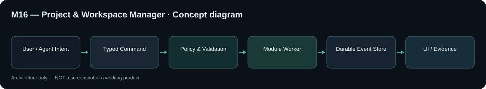

# Project & Workspace Manager — P01 verified subset and planned option contracts

**Module:** [M16 module contract](../../modules/M16.md)  
**Status:** Planned content; not yet a release user manual.  
**In-app Help route (planned):** `help://m16`  
**GitHub Wiki source:** [Wiki guide](../../wiki/pages/M16.md)  
**Concept diagram:** 

## Verified P01 read-only workspace transport (2026-11-22)

The native main-window `workspace.status` handshake is typed and deny-first, and reports that no workspace is configured. Workspace creation, filesystem import, project switching and actual backup/restore UI are **not implemented**. Screenshots for unimplemented options remain pending. [Native IPC CI](https://github.com/Vertex-Systems-Network/zynoa-2-local/actions/runs/44973070953).

**Visual evidence:** Actual running-app screenshots are pending CI capture and independent image inspection. Concept diagrams and browser previews do not satisfy the requirement. Planned options below are not enabled until separate implementation tests prove them.

## What this module is for

Unified projects, recent work, filesystem scopes and per-project state. Use this module when you need: projects; workspaces; imports; tabs; backups. This page becomes release-ready only when the linked screenshots are generated from the real running app and manually/automatically validated for content and accessibility.

## First-time workflow — P01 available subset

1. Launch the unsigned native P01 Windows desktop build; no released Workspace Manager exists.
2. Open **Overview** (sidebar or `Ctrl+1`) and inspect the read-only native handshake indicator. The expected state is **workspace not configured**.
3. Observe that **Create workspace** is disabled. Do not attempt to import folders or switch projects: those functions are not available in P01.
4. Open **Recovery** with `Ctrl+3`; it reports no verified backups and provides no working restore action.

**Not implemented:** workspace creation, import, project switching, backup/restore, a command palette, contextual `F1` Help and all option controls listed below.

## Each user option: purpose, behavior and screenshot contract

### M16-OPT-01 — Create workspace

- **Purpose:** Access the create workspace workflow in Project & Workspace Manager; this option must solve a specific user task, not be decorative.
- **Preconditions:** Active project/module, compatible dependencies and granted scope; if absent, show a remediation action.
- **Control contract:** Final control type/default/allowed values MUST be recorded after P01 UI spike; no guessed setting values are presented here as implemented.
- **Expected behavior:** Persist relevant settings and show the verified result or progress with cancel/retry where supported.
- **Failure behavior:** Display a stable error code, actionable recovery, diagnostics link and preserve prior valid state.
- **Accessibility:** Keyboard operation, visible focus and complete accessible label.
- **Actual screenshot:** `../../screenshots/M16/M16-OPT-01.png` — **PENDING** until the working module is built; a real annotated image with alt text is mandatory for final acceptance.
- **Automated evidence:** `M16-OPT-01` visual/component/E2E test and success/failure log (required in implementation PR).

### M16-OPT-02 — Import directory

- **Purpose:** Access the import directory workflow in Project & Workspace Manager; this option must solve a specific user task, not be decorative.
- **Preconditions:** Active project/module, compatible dependencies and granted scope; if absent, show a remediation action.
- **Control contract:** Final control type/default/allowed values MUST be recorded after P01 UI spike; no guessed setting values are presented here as implemented.
- **Expected behavior:** Persist relevant settings and show the verified result or progress with cancel/retry where supported.
- **Failure behavior:** Display a stable error code, actionable recovery, diagnostics link and preserve prior valid state.
- **Accessibility:** Keyboard operation, visible focus and complete accessible label.
- **Actual screenshot:** `../../screenshots/M16/M16-OPT-02.png` — **PENDING** until the working module is built; a real annotated image with alt text is mandatory for final acceptance.
- **Automated evidence:** `M16-OPT-02` visual/component/E2E test and success/failure log (required in implementation PR).

### M16-OPT-03 — Switch projects

- **Purpose:** Access the switch projects workflow in Project & Workspace Manager; this option must solve a specific user task, not be decorative.
- **Preconditions:** Active project/module, compatible dependencies and granted scope; if absent, show a remediation action.
- **Control contract:** Final control type/default/allowed values MUST be recorded after P01 UI spike; no guessed setting values are presented here as implemented.
- **Expected behavior:** Persist relevant settings and show the verified result or progress with cancel/retry where supported.
- **Failure behavior:** Display a stable error code, actionable recovery, diagnostics link and preserve prior valid state.
- **Accessibility:** Keyboard operation, visible focus and complete accessible label.
- **Actual screenshot:** `../../screenshots/M16/M16-OPT-03.png` — **PENDING** until the working module is built; a real annotated image with alt text is mandatory for final acceptance.
- **Automated evidence:** `M16-OPT-03` visual/component/E2E test and success/failure log (required in implementation PR).

### M16-OPT-04 — Configure file exclusions

- **Purpose:** Access the configure file exclusions workflow in Project & Workspace Manager; this option must solve a specific user task, not be decorative.
- **Preconditions:** Active project/module, compatible dependencies and granted scope; if absent, show a remediation action.
- **Control contract:** Final control type/default/allowed values MUST be recorded after P01 UI spike; no guessed setting values are presented here as implemented.
- **Expected behavior:** Persist relevant settings and show the verified result or progress with cancel/retry where supported.
- **Failure behavior:** Display a stable error code, actionable recovery, diagnostics link and preserve prior valid state.
- **Accessibility:** Keyboard operation, visible focus and complete accessible label.
- **Actual screenshot:** `../../screenshots/M16/M16-OPT-04.png` — **PENDING** until the working module is built; a real annotated image with alt text is mandatory for final acceptance.
- **Automated evidence:** `M16-OPT-04` visual/component/E2E test and success/failure log (required in implementation PR).

### M16-OPT-05 — Pin recent project

- **Purpose:** Access the pin recent project workflow in Project & Workspace Manager; this option must solve a specific user task, not be decorative.
- **Preconditions:** Active project/module, compatible dependencies and granted scope; if absent, show a remediation action.
- **Control contract:** Final control type/default/allowed values MUST be recorded after P01 UI spike; no guessed setting values are presented here as implemented.
- **Expected behavior:** Persist relevant settings and show the verified result or progress with cancel/retry where supported.
- **Failure behavior:** Display a stable error code, actionable recovery, diagnostics link and preserve prior valid state.
- **Accessibility:** Keyboard operation, visible focus and complete accessible label.
- **Actual screenshot:** `../../screenshots/M16/M16-OPT-05.png` — **PENDING** until the working module is built; a real annotated image with alt text is mandatory for final acceptance.
- **Automated evidence:** `M16-OPT-05` visual/component/E2E test and success/failure log (required in implementation PR).

### M16-OPT-06 — Snapshot workspace

- **Purpose:** Access the snapshot workspace workflow in Project & Workspace Manager; this option must solve a specific user task, not be decorative.
- **Preconditions:** Active project/module, compatible dependencies and granted scope; if absent, show a remediation action.
- **Control contract:** Final control type/default/allowed values MUST be recorded after P01 UI spike; no guessed setting values are presented here as implemented.
- **Expected behavior:** Persist relevant settings and show the verified result or progress with cancel/retry where supported.
- **Failure behavior:** Display a stable error code, actionable recovery, diagnostics link and preserve prior valid state.
- **Accessibility:** Keyboard operation, visible focus and complete accessible label.
- **Actual screenshot:** `../../screenshots/M16/M16-OPT-06.png` — **PENDING** until the working module is built; a real annotated image with alt text is mandatory for final acceptance.
- **Automated evidence:** `M16-OPT-06` visual/component/E2E test and success/failure log (required in implementation PR).

### M16-OPT-07 — Restore backup

- **Purpose:** Access the restore backup workflow in Project & Workspace Manager; this option must solve a specific user task, not be decorative.
- **Preconditions:** Active project/module, compatible dependencies and granted scope; if absent, show a remediation action.
- **Control contract:** Final control type/default/allowed values MUST be recorded after P01 UI spike; no guessed setting values are presented here as implemented.
- **Expected behavior:** Persist relevant settings and show the verified result or progress with cancel/retry where supported.
- **Failure behavior:** Display a stable error code, actionable recovery, diagnostics link and preserve prior valid state.
- **Accessibility:** Keyboard operation, visible focus and complete accessible label.
- **Actual screenshot:** `../../screenshots/M16/M16-OPT-07.png` — **PENDING** until the working module is built; a real annotated image with alt text is mandatory for final acceptance.
- **Automated evidence:** `M16-OPT-07` visual/component/E2E test and success/failure log (required in implementation PR).

### M16-OPT-08 — Archive project

- **Purpose:** Access the archive project workflow in Project & Workspace Manager; this option must solve a specific user task, not be decorative.
- **Preconditions:** Active project/module, compatible dependencies and granted scope; if absent, show a remediation action.
- **Control contract:** Final control type/default/allowed values MUST be recorded after P01 UI spike; no guessed setting values are presented here as implemented.
- **Expected behavior:** Persist relevant settings and show the verified result or progress with cancel/retry where supported.
- **Failure behavior:** Display a stable error code, actionable recovery, diagnostics link and preserve prior valid state.
- **Accessibility:** Keyboard operation, visible focus and complete accessible label.
- **Actual screenshot:** `../../screenshots/M16/M16-OPT-08.png` — **PENDING** until the working module is built; a real annotated image with alt text is mandatory for final acceptance.
- **Automated evidence:** `M16-OPT-08` visual/component/E2E test and success/failure log (required in implementation PR).

## Troubleshooting and privacy

The P01 GUI cannot create, open or recover a workspace. If the read-only handshake fails, reopen the disposable native build and consult developer-only CI logs. There is no user-visible incident ID or support submission flow. Never attach raw project files, paths or credentials to public issues.

## Related articles and support

[All help topics](../README.md) · [Wiki index](../../wiki/README.md) · [Security & reporting](../../operations/ISSUE_AUTOMATION.md) · [Option catalog](../../ui/OPTION_CATALOG.csv).

**Release documentation gate:** Pending screenshots and unverified controls cannot ship as completed help. This document is a content specification until actual implementation replaces placeholders with tested instructions.
