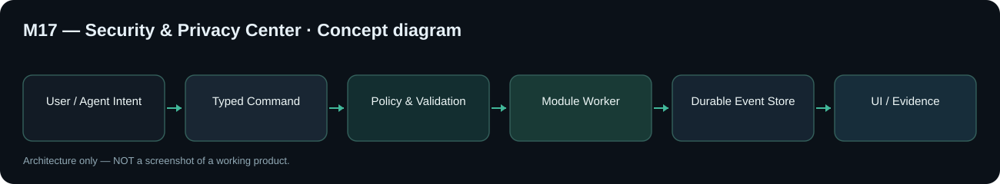

# Security & Privacy Center — P01 verified subset and planned option contracts

**Module:** [M17 module contract](../../modules/M17.md)  
**Status:** Verified P01 foundation subset; complete option guide and release Help UI remain planned.  
**In-app Help route (planned):** `help://m17`  
**GitHub Wiki source:** [Wiki guide](../../wiki/pages/M17.md)  
**Concept diagram:** 

## Verified P01 native-only security foundation (2026-11-22)

A Rust Windows Credential Manager adapter, sanitized secret errors and deny-first native capability checks passed Windows tests. The WebView has no API to read/write credentials. This is **not** a production-signed installer, a permission grant screen or a complete Security Center; the planned option controls and screenshots remain pending. [Native security CI](https://github.com/Vertex-Systems-Network/zynoa-2-local/actions/runs/44973840898).

**Reviewed actual native evidence:** [Restricted Settings](../../screenshots/M01/P01-Settings-preview.png) shows disabled preference controls; [Windows CI](https://github.com/Vertex-Systems-Network/zynoa-2-local/actions/runs/45006477419) independently verifies the native Rust security boundary. This is **not** a Security Center UI; permission/credential controls and screenshot obligations remain pending.

## What this module is for

Independent native policy enforcement and transparent local-first privacy. Use this module when you need: permissions; scopes; sandbox; secrets; consent. This page becomes release-ready only when the linked screenshots are generated from the real running app and manually/automatically validated for content and accessibility.

## First-time workflow — P01 available subset

1. Start the unsigned P01 Windows build in a disposable test environment and inspect **Overview** (`Ctrl+1`) to confirm the native shell is connected.
2. There is **no Security & Privacy Center UI** in this build. The native Rust capability broker and Windows credential adapter are verified by Windows CI, not exposed as interactive permission or secrets controls.
3. Open **Settings** (`Ctrl+2`) to confirm user-facing preferences are disabled; the page does not grant filesystem, network or secret-store permissions.

**Not implemented:** user-grant/revoke screens, credential management UI, audit journal browsing, consent dialog, remote telemetry controls, `F1` Help and screenshot/option workflows below.

## Each user option: purpose, behavior and screenshot contract

### M17-OPT-01 — Manage approved paths

- **Purpose:** Access the manage approved paths workflow in Security & Privacy Center; this option must solve a specific user task, not be decorative.
- **Preconditions:** Active project/module, compatible dependencies and granted scope; if absent, show a remediation action.
- **Control contract:** Final control type/default/allowed values MUST be recorded after P01 UI spike; no guessed setting values are presented here as implemented.
- **Expected behavior:** Persist relevant settings and show the verified result or progress with cancel/retry where supported.
- **Failure behavior:** Display a stable error code, actionable recovery, diagnostics link and preserve prior valid state.
- **Accessibility:** Keyboard operation, visible focus and complete accessible label.
- **Actual screenshot:** `../../screenshots/M17/M17-OPT-01.png` — **PENDING** until the working module is built; a real annotated image with alt text is mandatory for final acceptance.
- **Automated evidence:** `M17-OPT-01` visual/component/E2E test and success/failure log (required in implementation PR).

### M17-OPT-02 — Set outbound domains

- **Purpose:** Access the set outbound domains workflow in Security & Privacy Center; this option must solve a specific user task, not be decorative.
- **Preconditions:** Active project/module, compatible dependencies and granted scope; if absent, show a remediation action.
- **Control contract:** Final control type/default/allowed values MUST be recorded after P01 UI spike; no guessed setting values are presented here as implemented.
- **Expected behavior:** Persist relevant settings and show the verified result or progress with cancel/retry where supported.
- **Failure behavior:** Display a stable error code, actionable recovery, diagnostics link and preserve prior valid state.
- **Accessibility:** Keyboard operation, visible focus and complete accessible label.
- **Actual screenshot:** `../../screenshots/M17/M17-OPT-02.png` — **PENDING** until the working module is built; a real annotated image with alt text is mandatory for final acceptance.
- **Automated evidence:** `M17-OPT-02` visual/component/E2E test and success/failure log (required in implementation PR).

### M17-OPT-03 — Review approval policy

- **Purpose:** Access the review approval policy workflow in Security & Privacy Center; this option must solve a specific user task, not be decorative.
- **Preconditions:** Active project/module, compatible dependencies and granted scope; if absent, show a remediation action.
- **Control contract:** Final control type/default/allowed values MUST be recorded after P01 UI spike; no guessed setting values are presented here as implemented.
- **Expected behavior:** Persist relevant settings and show the verified result or progress with cancel/retry where supported.
- **Failure behavior:** Display a stable error code, actionable recovery, diagnostics link and preserve prior valid state.
- **Accessibility:** Keyboard operation, visible focus and complete accessible label.
- **Actual screenshot:** `../../screenshots/M17/M17-OPT-03.png` — **PENDING** until the working module is built; a real annotated image with alt text is mandatory for final acceptance.
- **Automated evidence:** `M17-OPT-03` visual/component/E2E test and success/failure log (required in implementation PR).

### M17-OPT-04 — Local secrets store

- **Purpose:** Access the local secrets store workflow in Security & Privacy Center; this option must solve a specific user task, not be decorative.
- **Preconditions:** Active project/module, compatible dependencies and granted scope; if absent, show a remediation action.
- **Control contract:** Final control type/default/allowed values MUST be recorded after P01 UI spike; no guessed setting values are presented here as implemented.
- **Expected behavior:** Persist relevant settings and show the verified result or progress with cancel/retry where supported.
- **Failure behavior:** Display a stable error code, actionable recovery, diagnostics link and preserve prior valid state.
- **Accessibility:** Keyboard operation, visible focus and complete accessible label.
- **Actual screenshot:** `../../screenshots/M17/M17-OPT-04.png` — **PENDING** until the working module is built; a real annotated image with alt text is mandatory for final acceptance.
- **Automated evidence:** `M17-OPT-04` visual/component/E2E test and success/failure log (required in implementation PR).

### M17-OPT-05 — Privacy incident preview

- **Purpose:** Access the privacy incident preview workflow in Security & Privacy Center; this option must solve a specific user task, not be decorative.
- **Preconditions:** Active project/module, compatible dependencies and granted scope; if absent, show a remediation action.
- **Control contract:** Final control type/default/allowed values MUST be recorded after P01 UI spike; no guessed setting values are presented here as implemented.
- **Expected behavior:** Persist relevant settings and show the verified result or progress with cancel/retry where supported.
- **Failure behavior:** Display a stable error code, actionable recovery, diagnostics link and preserve prior valid state.
- **Accessibility:** Keyboard operation, visible focus and complete accessible label.
- **Actual screenshot:** `../../screenshots/M17/M17-OPT-05.png` — **PENDING** until the working module is built; a real annotated image with alt text is mandatory for final acceptance.
- **Automated evidence:** `M17-OPT-05` visual/component/E2E test and success/failure log (required in implementation PR).

### M17-OPT-06 — Check audit journal

- **Purpose:** Access the check audit journal workflow in Security & Privacy Center; this option must solve a specific user task, not be decorative.
- **Preconditions:** Active project/module, compatible dependencies and granted scope; if absent, show a remediation action.
- **Control contract:** Final control type/default/allowed values MUST be recorded after P01 UI spike; no guessed setting values are presented here as implemented.
- **Expected behavior:** Persist relevant settings and show the verified result or progress with cancel/retry where supported.
- **Failure behavior:** Display a stable error code, actionable recovery, diagnostics link and preserve prior valid state.
- **Accessibility:** Keyboard operation, visible focus and complete accessible label.
- **Actual screenshot:** `../../screenshots/M17/M17-OPT-06.png` — **PENDING** until the working module is built; a real annotated image with alt text is mandatory for final acceptance.
- **Automated evidence:** `M17-OPT-06` visual/component/E2E test and success/failure log (required in implementation PR).

### M17-OPT-07 — Revoke capability

- **Purpose:** Access the revoke capability workflow in Security & Privacy Center; this option must solve a specific user task, not be decorative.
- **Preconditions:** Active project/module, compatible dependencies and granted scope; if absent, show a remediation action.
- **Control contract:** Final control type/default/allowed values MUST be recorded after P01 UI spike; no guessed setting values are presented here as implemented.
- **Expected behavior:** Persist relevant settings and show the verified result or progress with cancel/retry where supported.
- **Failure behavior:** Display a stable error code, actionable recovery, diagnostics link and preserve prior valid state.
- **Accessibility:** Keyboard operation, visible focus and complete accessible label.
- **Actual screenshot:** `../../screenshots/M17/M17-OPT-07.png` — **PENDING** until the working module is built; a real annotated image with alt text is mandatory for final acceptance.
- **Automated evidence:** `M17-OPT-07` visual/component/E2E test and success/failure log (required in implementation PR).

### M17-OPT-08 — Policy validation

- **Purpose:** Access the policy validation workflow in Security & Privacy Center; this option must solve a specific user task, not be decorative.
- **Preconditions:** Active project/module, compatible dependencies and granted scope; if absent, show a remediation action.
- **Control contract:** Final control type/default/allowed values MUST be recorded after P01 UI spike; no guessed setting values are presented here as implemented.
- **Expected behavior:** Persist relevant settings and show the verified result or progress with cancel/retry where supported.
- **Failure behavior:** Display a stable error code, actionable recovery, diagnostics link and preserve prior valid state.
- **Accessibility:** Keyboard operation, visible focus and complete accessible label.
- **Actual screenshot:** `../../screenshots/M17/M17-OPT-08.png` — **PENDING** until the working module is built; a real annotated image with alt text is mandatory for final acceptance.
- **Automated evidence:** `M17-OPT-08` visual/component/E2E test and success/failure log (required in implementation PR).

## Troubleshooting and privacy

Security capabilities are native-only in this phase; no user-facing permission manager or incident ID exists. Inspect the Windows CI security contract checks for developer failures. Do not expose OS credential values, raw file paths or private data to issue automation.

## Related articles and support

[All help topics](../README.md) · [Wiki index](../../wiki/README.md) · [Security & reporting](../../operations/ISSUE_AUTOMATION.md) · [Option catalog](../../ui/OPTION_CATALOG.csv).

**Release documentation gate:** Pending screenshots and unverified controls cannot ship as completed help. This document is a content specification until actual implementation replaces placeholders with tested instructions.
