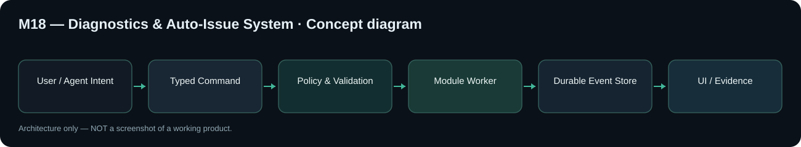

# Diagnostics & Auto-Issue System — P01 verified subset and planned option contracts

**Module:** [M18 module contract](../../modules/M18.md)  
**Status:** Verified P01 foundation subset; complete option guide and release Help UI remain planned.  
**In-app Help route (planned):** `help://m18`  
**GitHub Wiki source:** [Wiki guide](../../wiki/pages/M18.md)  
**Concept diagram:** 

## Verified P01 bounded local diagnostic foundation (2026-11-22)

Tauri records fixed local categories for boot, denied IPC and sanitized Rust panic, in a bounded append-only native spool. The Diagnostics desktop view is only a capabilities summary, **not** an incident viewer, remote issue uploader or privacy approval interface. No raw error message, file path, prompt or secret is accepted by the bounded event API. Screenshot obligations for missing controls remain pending. [Native diagnostics CI](https://github.com/Vertex-Systems-Network/zynoa-2-local/actions/runs/44980027777).

**Reviewed actual native evidence:** [Diagnostics summary](../../screenshots/M01/P01-Diagnostics-preview.png) is an authentic native screen from [Windows CI](https://github.com/Vertex-Systems-Network/zynoa-2-local/actions/runs/45006477419), with exact-hash proof in [GitHub](https://github.com/Vertex-Systems-Network/zynoa-2-local/commit/1b582a6d5968b105de3143d3f5294aac7d4cd0de). It does not render live incidents or publish GitHub issues; planned feature/option screenshots remain pending.

## What this module is for

Crash/error detection, safe grouping, queued reports and GitHub issue tracking. Use this module when you need: crashes; warnings; fingerprint; dedupe; triage; reports. This page becomes release-ready only when the linked screenshots are generated from the real running app and manually/automatically validated for content and accessibility.

## First-time workflow — P01 available subset

1. Open **Diagnostics** in the unsigned P01 Windows build using the sidebar or `Ctrl+4`.
2. Read the capability summary for local event categories and disabled remote reporting. It is **not** a live incident log or device health scan.
3. Native boot/denial/crash records and redaction are verified in Windows CI fixtures; the UI does **not** show event lists, incident IDs, an issue queue or a report preview.

**Not implemented:** issue publishing, per-project diagnostics choices, retry controls, incident history, `F1` contextual Help and the option screens below.

## Each user option: purpose, behavior and screenshot contract

### M18-OPT-01 — Inspect crash signature

- **Purpose:** Access the inspect crash signature workflow in Diagnostics & Auto-Issue System; this option must solve a specific user task, not be decorative.
- **Preconditions:** Active project/module, compatible dependencies and granted scope; if absent, show a remediation action.
- **Control contract:** Final control type/default/allowed values MUST be recorded after P01 UI spike; no guessed setting values are presented here as implemented.
- **Expected behavior:** Persist relevant settings and show the verified result or progress with cancel/retry where supported.
- **Failure behavior:** Display a stable error code, actionable recovery, diagnostics link and preserve prior valid state.
- **Accessibility:** Keyboard operation, visible focus and complete accessible label.
- **Actual screenshot:** `../../screenshots/M18/M18-OPT-01.png` — **PENDING** until the working module is built; a real annotated image with alt text is mandatory for final acceptance.
- **Automated evidence:** `M18-OPT-01` visual/component/E2E test and success/failure log (required in implementation PR).

### M18-OPT-02 — Group identical errors

- **Purpose:** Access the group identical errors workflow in Diagnostics & Auto-Issue System; this option must solve a specific user task, not be decorative.
- **Preconditions:** Active project/module, compatible dependencies and granted scope; if absent, show a remediation action.
- **Control contract:** Final control type/default/allowed values MUST be recorded after P01 UI spike; no guessed setting values are presented here as implemented.
- **Expected behavior:** Persist relevant settings and show the verified result or progress with cancel/retry where supported.
- **Failure behavior:** Display a stable error code, actionable recovery, diagnostics link and preserve prior valid state.
- **Accessibility:** Keyboard operation, visible focus and complete accessible label.
- **Actual screenshot:** `../../screenshots/M18/M18-OPT-02.png` — **PENDING** until the working module is built; a real annotated image with alt text is mandatory for final acceptance.
- **Automated evidence:** `M18-OPT-02` visual/component/E2E test and success/failure log (required in implementation PR).

### M18-OPT-03 — View redacted report

- **Purpose:** Access the view redacted report workflow in Diagnostics & Auto-Issue System; this option must solve a specific user task, not be decorative.
- **Preconditions:** Active project/module, compatible dependencies and granted scope; if absent, show a remediation action.
- **Control contract:** Final control type/default/allowed values MUST be recorded after P01 UI spike; no guessed setting values are presented here as implemented.
- **Expected behavior:** Persist relevant settings and show the verified result or progress with cancel/retry where supported.
- **Failure behavior:** Display a stable error code, actionable recovery, diagnostics link and preserve prior valid state.
- **Accessibility:** Keyboard operation, visible focus and complete accessible label.
- **Actual screenshot:** `../../screenshots/M18/M18-OPT-03.png` — **PENDING** until the working module is built; a real annotated image with alt text is mandatory for final acceptance.
- **Automated evidence:** `M18-OPT-03` visual/component/E2E test and success/failure log (required in implementation PR).

### M18-OPT-04 — Enable project diagnostics

- **Purpose:** Access the enable project diagnostics workflow in Diagnostics & Auto-Issue System; this option must solve a specific user task, not be decorative.
- **Preconditions:** Active project/module, compatible dependencies and granted scope; if absent, show a remediation action.
- **Control contract:** Final control type/default/allowed values MUST be recorded after P01 UI spike; no guessed setting values are presented here as implemented.
- **Expected behavior:** Persist relevant settings and show the verified result or progress with cancel/retry where supported.
- **Failure behavior:** Display a stable error code, actionable recovery, diagnostics link and preserve prior valid state.
- **Accessibility:** Keyboard operation, visible focus and complete accessible label.
- **Actual screenshot:** `../../screenshots/M18/M18-OPT-04.png` — **PENDING** until the working module is built; a real annotated image with alt text is mandatory for final acceptance.
- **Automated evidence:** `M18-OPT-04` visual/component/E2E test and success/failure log (required in implementation PR).

### M18-OPT-05 — Link GitHub issue

- **Purpose:** Access the link github issue workflow in Diagnostics & Auto-Issue System; this option must solve a specific user task, not be decorative.
- **Preconditions:** Active project/module, compatible dependencies and granted scope; if absent, show a remediation action.
- **Control contract:** Final control type/default/allowed values MUST be recorded after P01 UI spike; no guessed setting values are presented here as implemented.
- **Expected behavior:** Persist relevant settings and show the verified result or progress with cancel/retry where supported.
- **Failure behavior:** Display a stable error code, actionable recovery, diagnostics link and preserve prior valid state.
- **Accessibility:** Keyboard operation, visible focus and complete accessible label.
- **Actual screenshot:** `../../screenshots/M18/M18-OPT-05.png` — **PENDING** until the working module is built; a real annotated image with alt text is mandatory for final acceptance.
- **Automated evidence:** `M18-OPT-05` visual/component/E2E test and success/failure log (required in implementation PR).

### M18-OPT-06 — Retry queued report

- **Purpose:** Access the retry queued report workflow in Diagnostics & Auto-Issue System; this option must solve a specific user task, not be decorative.
- **Preconditions:** Active project/module, compatible dependencies and granted scope; if absent, show a remediation action.
- **Control contract:** Final control type/default/allowed values MUST be recorded after P01 UI spike; no guessed setting values are presented here as implemented.
- **Expected behavior:** Persist relevant settings and show the verified result or progress with cancel/retry where supported.
- **Failure behavior:** Display a stable error code, actionable recovery, diagnostics link and preserve prior valid state.
- **Accessibility:** Keyboard operation, visible focus and complete accessible label.
- **Actual screenshot:** `../../screenshots/M18/M18-OPT-06.png` — **PENDING** until the working module is built; a real annotated image with alt text is mandatory for final acceptance.
- **Automated evidence:** `M18-OPT-06` visual/component/E2E test and success/failure log (required in implementation PR).

### M18-OPT-07 — Mark fixed build

- **Purpose:** Access the mark fixed build workflow in Diagnostics & Auto-Issue System; this option must solve a specific user task, not be decorative.
- **Preconditions:** Active project/module, compatible dependencies and granted scope; if absent, show a remediation action.
- **Control contract:** Final control type/default/allowed values MUST be recorded after P01 UI spike; no guessed setting values are presented here as implemented.
- **Expected behavior:** Persist relevant settings and show the verified result or progress with cancel/retry where supported.
- **Failure behavior:** Display a stable error code, actionable recovery, diagnostics link and preserve prior valid state.
- **Accessibility:** Keyboard operation, visible focus and complete accessible label.
- **Actual screenshot:** `../../screenshots/M18/M18-OPT-07.png` — **PENDING** until the working module is built; a real annotated image with alt text is mandatory for final acceptance.
- **Automated evidence:** `M18-OPT-07` visual/component/E2E test and success/failure log (required in implementation PR).

### M18-OPT-08 — Export local diagnostics

- **Purpose:** Access the export local diagnostics workflow in Diagnostics & Auto-Issue System; this option must solve a specific user task, not be decorative.
- **Preconditions:** Active project/module, compatible dependencies and granted scope; if absent, show a remediation action.
- **Control contract:** Final control type/default/allowed values MUST be recorded after P01 UI spike; no guessed setting values are presented here as implemented.
- **Expected behavior:** Persist relevant settings and show the verified result or progress with cancel/retry where supported.
- **Failure behavior:** Display a stable error code, actionable recovery, diagnostics link and preserve prior valid state.
- **Accessibility:** Keyboard operation, visible focus and complete accessible label.
- **Actual screenshot:** `../../screenshots/M18/M18-OPT-08.png` — **PENDING** until the working module is built; a real annotated image with alt text is mandatory for final acceptance.
- **Automated evidence:** `M18-OPT-08` visual/component/E2E test and success/failure log (required in implementation PR).

## Troubleshooting and privacy

No incident ID is displayed in the P01 Diagnostics view. Developer diagnostics are native local records and test fixtures, not an in-app log reader or user report queue. Do not upload private content, raw paths or credentials; public issue reporting is not an enabled product feature.

## Related articles and support

[All help topics](../README.md) · [Wiki index](../../wiki/README.md) · [Security & reporting](../../operations/ISSUE_AUTOMATION.md) · [Option catalog](../../ui/OPTION_CATALOG.csv).

**Release documentation gate:** Pending screenshots and unverified controls cannot ship as completed help. This document is a content specification until actual implementation replaces placeholders with tested instructions.
