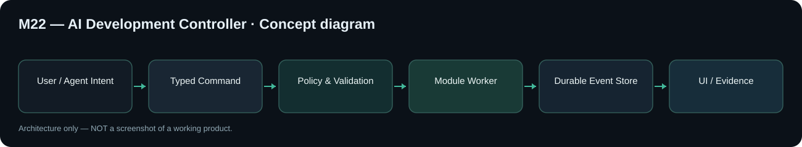

# AI Development Controller — complete user guide

**Module:** [M22 module contract](../../modules/M22.md)  
**Status:** Planned content; not yet a release user manual.  
**In-app Help route (planned):** `help://m22`  
**GitHub Wiki source:** [Wiki guide](../../wiki/pages/M22.md)  
**Concept diagram:** 

## What this module is for

External persistent worker enforcing phase branch PR and governed autonomous loop. Use this module when you need: phase state; branch; PR; CI; auto merge; memory. This page becomes release-ready only when the linked screenshots are generated from the real running app and manually/automatically validated for content and accessibility.

## First-time workflow

1. Open the relevant module from the desktop navigation or global command palette.
2. Check the visible status indicator, permissions and prerequisites; never assume all optional workers are installed.
3. Select the project/workspace/context the module should operate on.
4. Configure the relevant option from the reference below, noting default and supported values.
5. Execute a small real task and review the actual artifact/status/log.
6. If operation fails, open Diagnostics with its local incident ID and follow the troubleshooting section.
7. Return to contextual Help using `F1` or the documented help action (pending implementation verification).

## Each user option: purpose, behavior and screenshot contract

### M22-OPT-01 — Read active phase

- **Purpose:** Access the read active phase workflow in AI Development Controller; this option must solve a specific user task, not be decorative.
- **Preconditions:** Active project/module, compatible dependencies and granted scope; if absent, show a remediation action.
- **Control contract:** Final control type/default/allowed values MUST be recorded after P00 UI spike; no guessed setting values are presented here as implemented.
- **Expected behavior:** Persist relevant settings and show the verified result or progress with cancel/retry where supported.
- **Failure behavior:** Display a stable error code, actionable recovery, diagnostics link and preserve prior valid state.
- **Accessibility:** Keyboard operation, visible focus and complete accessible label.
- **Actual screenshot:** `../../screenshots/M22/M22-OPT-01.png` — **PENDING** until the working module is built; a real annotated image with alt text is mandatory for final acceptance.
- **Automated evidence:** `M22-OPT-01` visual/component/E2E test and success/failure log (required in implementation PR).

### M22-OPT-02 — Create phase branch

- **Purpose:** Access the create phase branch workflow in AI Development Controller; this option must solve a specific user task, not be decorative.
- **Preconditions:** Active project/module, compatible dependencies and granted scope; if absent, show a remediation action.
- **Control contract:** Final control type/default/allowed values MUST be recorded after P00 UI spike; no guessed setting values are presented here as implemented.
- **Expected behavior:** Persist relevant settings and show the verified result or progress with cancel/retry where supported.
- **Failure behavior:** Display a stable error code, actionable recovery, diagnostics link and preserve prior valid state.
- **Accessibility:** Keyboard operation, visible focus and complete accessible label.
- **Actual screenshot:** `../../screenshots/M22/M22-OPT-02.png` — **PENDING** until the working module is built; a real annotated image with alt text is mandatory for final acceptance.
- **Automated evidence:** `M22-OPT-02` visual/component/E2E test and success/failure log (required in implementation PR).

### M22-OPT-03 — Open/update phase PR

- **Purpose:** Access the open/update phase pr workflow in AI Development Controller; this option must solve a specific user task, not be decorative.
- **Preconditions:** Active project/module, compatible dependencies and granted scope; if absent, show a remediation action.
- **Control contract:** Final control type/default/allowed values MUST be recorded after P00 UI spike; no guessed setting values are presented here as implemented.
- **Expected behavior:** Persist relevant settings and show the verified result or progress with cancel/retry where supported.
- **Failure behavior:** Display a stable error code, actionable recovery, diagnostics link and preserve prior valid state.
- **Accessibility:** Keyboard operation, visible focus and complete accessible label.
- **Actual screenshot:** `../../screenshots/M22/M22-OPT-03.png` — **PENDING** until the working module is built; a real annotated image with alt text is mandatory for final acceptance.
- **Automated evidence:** `M22-OPT-03` visual/component/E2E test and success/failure log (required in implementation PR).

### M22-OPT-04 — Observe CI checks

- **Purpose:** Access the observe ci checks workflow in AI Development Controller; this option must solve a specific user task, not be decorative.
- **Preconditions:** Active project/module, compatible dependencies and granted scope; if absent, show a remediation action.
- **Control contract:** Final control type/default/allowed values MUST be recorded after P00 UI spike; no guessed setting values are presented here as implemented.
- **Expected behavior:** Persist relevant settings and show the verified result or progress with cancel/retry where supported.
- **Failure behavior:** Display a stable error code, actionable recovery, diagnostics link and preserve prior valid state.
- **Accessibility:** Keyboard operation, visible focus and complete accessible label.
- **Actual screenshot:** `../../screenshots/M22/M22-OPT-04.png` — **PENDING** until the working module is built; a real annotated image with alt text is mandatory for final acceptance.
- **Automated evidence:** `M22-OPT-04` visual/component/E2E test and success/failure log (required in implementation PR).

### M22-OPT-05 — Fix test failures

- **Purpose:** Access the fix test failures workflow in AI Development Controller; this option must solve a specific user task, not be decorative.
- **Preconditions:** Active project/module, compatible dependencies and granted scope; if absent, show a remediation action.
- **Control contract:** Final control type/default/allowed values MUST be recorded after P00 UI spike; no guessed setting values are presented here as implemented.
- **Expected behavior:** Persist relevant settings and show the verified result or progress with cancel/retry where supported.
- **Failure behavior:** Display a stable error code, actionable recovery, diagnostics link and preserve prior valid state.
- **Accessibility:** Keyboard operation, visible focus and complete accessible label.
- **Actual screenshot:** `../../screenshots/M22/M22-OPT-05.png` — **PENDING** until the working module is built; a real annotated image with alt text is mandatory for final acceptance.
- **Automated evidence:** `M22-OPT-05` visual/component/E2E test and success/failure log (required in implementation PR).

### M22-OPT-06 — Reconcile GitHub status

- **Purpose:** Access the reconcile github status workflow in AI Development Controller; this option must solve a specific user task, not be decorative.
- **Preconditions:** Active project/module, compatible dependencies and granted scope; if absent, show a remediation action.
- **Control contract:** Final control type/default/allowed values MUST be recorded after P00 UI spike; no guessed setting values are presented here as implemented.
- **Expected behavior:** Persist relevant settings and show the verified result or progress with cancel/retry where supported.
- **Failure behavior:** Display a stable error code, actionable recovery, diagnostics link and preserve prior valid state.
- **Accessibility:** Keyboard operation, visible focus and complete accessible label.
- **Actual screenshot:** `../../screenshots/M22/M22-OPT-06.png` — **PENDING** until the working module is built; a real annotated image with alt text is mandatory for final acceptance.
- **Automated evidence:** `M22-OPT-06` visual/component/E2E test and success/failure log (required in implementation PR).

### M22-OPT-07 — Validate merge gate

- **Purpose:** Access the validate merge gate workflow in AI Development Controller; this option must solve a specific user task, not be decorative.
- **Preconditions:** Active project/module, compatible dependencies and granted scope; if absent, show a remediation action.
- **Control contract:** Final control type/default/allowed values MUST be recorded after P00 UI spike; no guessed setting values are presented here as implemented.
- **Expected behavior:** Persist relevant settings and show the verified result or progress with cancel/retry where supported.
- **Failure behavior:** Display a stable error code, actionable recovery, diagnostics link and preserve prior valid state.
- **Accessibility:** Keyboard operation, visible focus and complete accessible label.
- **Actual screenshot:** `../../screenshots/M22/M22-OPT-07.png` — **PENDING** until the working module is built; a real annotated image with alt text is mandatory for final acceptance.
- **Automated evidence:** `M22-OPT-07` visual/component/E2E test and success/failure log (required in implementation PR).

### M22-OPT-08 — Start next phase

- **Purpose:** Access the start next phase workflow in AI Development Controller; this option must solve a specific user task, not be decorative.
- **Preconditions:** Active project/module, compatible dependencies and granted scope; if absent, show a remediation action.
- **Control contract:** Final control type/default/allowed values MUST be recorded after P00 UI spike; no guessed setting values are presented here as implemented.
- **Expected behavior:** Persist relevant settings and show the verified result or progress with cancel/retry where supported.
- **Failure behavior:** Display a stable error code, actionable recovery, diagnostics link and preserve prior valid state.
- **Accessibility:** Keyboard operation, visible focus and complete accessible label.
- **Actual screenshot:** `../../screenshots/M22/M22-OPT-08.png` — **PENDING** until the working module is built; a real annotated image with alt text is mandatory for final acceptance.
- **Automated evidence:** `M22-OPT-08` visual/component/E2E test and success/failure log (required in implementation PR).

## Troubleshooting and privacy

Use the incident ID displayed in Diagnostics; check whether the failure is missing dependency, offline provider, permissions, insufficient memory, invalid settings or interrupted job. Report reproducible development errors automatically through the repo controller; user diagnostics can be forwarded only under the local reporting settings and with sanitized fields. Raw content, files and credentials are never attached to public tickets.

## Related articles and support

[All help topics](../README.md) · [Wiki index](../../wiki/README.md) · [Security & reporting](../../operations/ISSUE_AUTOMATION.md) · [Option catalog](../../ui/OPTION_CATALOG.csv).

**Release documentation gate:** Pending screenshots and unverified controls cannot ship as completed help. This document is a content specification until actual implementation replaces placeholders with tested instructions.

## P00 advanced operator guidance (not an in-app screen yet)

Backend governance utilities currently available on P00 draft PR #1: `python -m tools.phase_worker --once` reads authenticated GitHub state using a scoped read-only token and prints a safe PR/CI/blocker report. Running without the required credentials is blocked; running does not merge the PR. For a production-host service and secure credential setup, see [P00 Worker Runbook](../../operations/P00_WORKER_RUNBOOK.md). Operator must configure protected `main` with required governance checks before the future transition executor is allowed. The CLI has no real GUI screenshot; all M22 screen and option captures remain **PENDING** until a working GUI is implemented. See [ADR-0009](../../adr/0009-phase-observer-boundary.md). Documentation for actual in-app development dashboard will be added when its running UI exists.

## P00 developer-only job queue CLI (no desktop screenshot yet)

To validate the *current* M22 read-only development queue, run `python -m tools.dev_job_runner --smoke --repo-root . --db <writable-local-sqlite-path>` from the active P00 checkout. The command creates and verifies three fixed governance checks, then prints persisted job states and confirms zero GitHub writes/model operations. Repeating a job ID with the same spec is idempotent; changing the spec under the same ID is rejected. If a job fails, check `RETRY_WAIT` or `BLOCKED` status and the sanitized error class; never interpret a failed job as a success. See [exact command and failure behavior](../../operations/P00_DURABLE_JOB_QUEUE.md).

This is not an app screen and there is no runnable UI; all existing M22-OPT screenshot requirements remain PENDING. Actual in-app Help screenshots will only be captured when M22 graphical interface is implemented. For GitHub merge controls, effective branch rules and required trusted check source are mandatory; `main` is currently unprotected and P00 must not be advanced.

## P00 developer CLI: dependency order and recovery (not an in-app GUI)

Run `python -m tools.dev_job_runner --smoke --repo-root . --db <fresh-writable-db-path>` on P00. The three jobs execute in a verified dependency chain: `phase-policy` → `design-spec` → `docs-integrity`, regardless of inverse priorities. The queue persists job and prerequisite states in SQLite; a failed prerequisite leaves dependents waiting/retrying or terminal BLOCKED, never silently successful. Wrong-phase edges, cycle attempts and corrupt parent rows are rejected. See [complete DAG Help](../../operations/P00_TASK_DEPENDENCY_GRAPH.md).

This is backend operator documentation. **No actual M22 in-app screenshot exists yet**, and no optional Help control has been represented as implemented. Module completion still requires full graphical UI and published Wiki links.

## P00 workspace and Git worktree policy — operator guide (no in-app screen yet)

The P00 backend now includes `tools/workspace_policy.py` and `tools/worktree_plan.py`. A trusted host can evaluate READ/WRITE requests **inside an already controlled task worktree** and create a deterministic detached/no-checkout Git worktree *plan* from an immutable SHA. The model is NOT allowed to select its own privileged source checkout/root, change its grant, execute shell commands, delete files, view secrets, edit GitHub policy or change the active phase.

Denied requests return a privacy-safe `WORKSPACE_SCOPE_DENIED` status without the host's absolute filesystem path. Invalid branch/SHA, existing destination, symlink/junction root, untrusted Git metadata or nonempty hooks directory also produce a denial. To verify the available backend functionality, run `python -m unittest tests.test_workspace_policy -v`; its actual Git command operates ONLY on a freshly created disposable trusted fixture. The worktree planner itself never executes a command.

This is NOT a working in-app M22 file option or a production sandbox. Real UI screenshots, keyboard/accessibility states, host deployment, Windows secure file-handle enforcement, safe model tool execution and Wiki publication remain **PENDING**. [Worktree policy and limitations](../../operations/P00_WORKTREE_POLICY.md) · [ADR-0011](../../adr/0011-worktree-is-not-sandbox.md).
