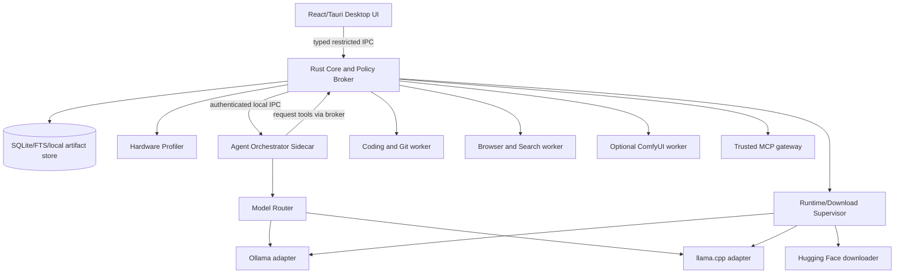

# Full AI Desktop Workspace — Production Blueprint

**Version:** 1.0 · **Date:** 2026-11-18 · **Product type:** Windows-first, local-first desktop AI agent workspace  
**North star:** One secure desktop application for local AI chat, coding, design, web search, deep research, document knowledge, model downloads and tools. No mandatory paid AI service.

## 0. Product principles and scope

- **Local first:** Installed models and indexed files remain usable offline; discovery, downloading and live web research require internet.
- **Free base operation:** Do not depend on paid cloud inference. Free software does **not** imply zero hardware, network, signing or hosting costs.
- **Security first:** LLM output is untrusted. Privileged actions run only through an independently enforced policy gateway.
- **Modularity:** Chat, models, coding, research, browser and media are independently enabled and versioned.
- **Hardware-aware:** Never claim compatibility from RAM alone; test runtime, model format, quantization, context and VRAM.
- **Ownership and reversibility:** All edits are visible as diffs; checkpoints and Git-based rollback are first-class.
- **User control:** No silent installation of third-party runtimes, no model auto-download without approval, no silent upload of private data.

### In-scope v1
Windows 10/11 x64 native shell; Ollama and llama.cpp adapters; HF/Ollama catalog; system scanner; compatibility recommendations; model install/update/uninstall; chat; model router; bounded tool calling; project management; coding workspace with local Git; document RAG; web search/research with citations; Playwright browsing; local web design preview; optional ComfyUI media; audit/approval system; release/update flow.

### Deferred beyond v1
Always-on unattended cloud agents; fully autonomous deployments to arbitrary accounts; training/fine-tuning; native vector graphics editor competitive with Figma; advanced mobile apps; enterprise multi-user syncing; unrestricted remote desktop automation.

## 1. Reference stack (initial architecture decisions)

| Responsibility | Preferred option | Engineering rationale |
| --- | --- | --- |
| Desktop application | Tauri 2, Rust | System webview, native operations, signed installers, capability boundaries |
| Frontend | React, TypeScript, Vite | Mature modular interface and editor integrations |
| UI | Tailwind CSS, Radix UI, Lucide | Accessible components and design tokens |
| State | Zustand, TanStack Query | Local state and async server-state isolation |
| Core/backend | Rust native services | Hardware inventory, process supervision, secured file and OS operations |
| Agent orchestrator | TypeScript worker packaged as a versioned sidecar | Agent SDK ecosystem and portable workflows; private IPC to Rust; no privileged independent OS access |
| Main inference | Ollama HTTP adapter | User-friendly local runtime, tool calling and management APIs |
| Alternative inference | llama.cpp server adapter | Direct GGUF and additional backend flexibility |
| HF downloads | `huggingface_hub` via isolated downloader worker | Metadata, pinned revisions, dry runs and caching |
| Coding | Monaco, xterm.js, Git, native task loop | Native editable coding workspace; optional OpenCode bridge later |
| Design | React component generator, sandboxed dev server, Playwright capture | Code-first layouts with edit/preview/check workflow |
| Media | Optional separately installed ComfyUI worker | Modular diffusion workflow; not a dependency for initial shell |
| Search | Self-hosted/configured SearXNG adapter; alternative providers optional | JSON search and local control, with engine availability caveats |
| Research | Playwright, fetch/extract, parsers, citation verifier | Evidence-first answers |
| Data | SQLite in WAL mode, FTS5, optional vector index | Durable local data and fast text search |
| Integration | MCP clients + trusted typed tools | Extensible connections without giving every server full access |
| Install/update | Signed installers, Tauri updater, pinned binary manifests | Supply-chain reliability |

**Packaging note:** Tauri itself does not provide Node.js by default. Any agent worker must be bundled, versioned, health-checked and updated explicitly. ComfyUI/Python and local model binaries must be optional separately managed packages, not unconditional large application dependencies.

## 2. Architecture and process boundaries



**Trust boundary:** UI, AI model, retrieved pages, tool descriptions and generated commands are untrusted. The Rust broker validates every action independently of the model. No direct shell plugin is exposed to untrusted React views.

### Required contracts

- `RuntimeAdapter`: `detect()`, `health()`, `listInstalled()`, `show()`, `pull()`, `cancelPull()`, `load()`, `unload()`, `generateStream()`, `embeddings()`, `capabilities()`.
- `ModelProvider`: `search()`, `getMetadata()`, `getLicense()`, `getFiles()`, `estimateDownload()`, `fetchVerified()`.
- `Tool`: `id`, `schema`, `capabilities`, `risk`, `validate()`, `authorize()`, `execute()`, `audit()`.
- `AgentRunner`: `start()`, `pause()`, `resume()`, `cancel()`, `checkpoint()`, `subscribeEvents()`.
- `KnowledgeConnector`: `ingest()`, `chunk()`, `index()`, `retrieve()`, `sourceInfo()`, `delete()`.
- `ArtifactProvider`: `createVersion()`, `diff()`, `preview()`, `export()`, `restore()`.

### IPC and event contract

Version all requests and responses with JSON Schema/Zod. Every event includes `schema_version`, `event_id`, `sequence`, `trace_id`, `job_id`, `timestamp`, `type`, `payload`. Use correlation IDs and ordered event replay. Large images/artifacts go to broker-controlled artifact files with read-scoped handles rather than huge IPC payloads. Sidecar endpoints use OS pipes or randomized loopback ports and an ephemeral secret; never bind sensitive servers to `0.0.0.0` by default.

## 3. Major modules and responsibilities

| ID | Module | User features | Backend requirements |
| --- | --- | --- | --- |
| M01 | Onboarding | Intro, hardware scan, setup consent, starter model | Install state machine, resumable setup |
| M02 | System Analyzer | CPU/RAM/GPU/VRAM/disk/drivers/OS | Native probes, accurate uncertainty states |
| M03 | Runtime Manager | Detect, install, start/stop, update Ollama/llama.cpp | Per-runtime adapters, process lifecycle |
| M04 | Model Gallery | Search, filters, licenses, verified model detail | Curated registry + HF/Ollama metadata |
| M05 | Download Manager | Pause/resume, progress, storage location, integrity | Retry/cache, hash/checksum, atomic install |
| M06 | Compatibility Engine | Recommended/slow/incompatible with reasons | Memory estimates + real test results |
| M07 | Model Router | Auto model per task, manual override, fallback | Capabilities, performance, availability |
| M08 | Chat | Streaming, attachments, branches, export | History, inference, prompt budget controls |
| M09 | Agent Tasks | Plan, steps, approvals, progress, retries | Persistent job runner, policy gateway |
| M10 | Project Manager | Local folders/repositories, workspaces | Scoped roots, file watcher, project metadata |
| M11 | Coding Studio | File tree, code editor, terminal, tests, diffs, Git | Sandbox/permissions, tool calls, test parsers |
| M12 | Research Studio | Search, sources, citations, compare, report | Search adapters, fetch/extract, evidence ledger |
| M13 | Knowledge Base | Local PDF/doc/text ingest and Q&A | Parsers, FTS, embeddings, chunk/source links |
| M14 | Browser Studio | Open, screenshot, inspect, click, form/test | Playwright with network and origin policy |
| M15 | Design Studio | React UI generation, visual preview, iteration | Generated project, dev server, screenshot/diff |
| M16 | Media Studio | Image generation, queue, workflows | Optional ComfyUI and model lifecycle |
| M17 | Tools/MCP | Install connectors, credentials, capabilities | Sandboxed or restricted servers, version checks |
| M18 | Security Center | File/network/tool permissions, approvals, revoke | Policy database, deny-by-default decisions |
| M19 | Activity & Diagnostics | Event log, crashes, model health, performance | Redaction, telemetry opt-in, structured logs |
| M20 | Settings & Updates | Theme, language, defaults, storage, updates | Atomic migrations, signed update verification |

## 4. Desktop interface and screen specs

Global shell: left icon navigation (expandable 220–260px), tab header/breadcrumb, main working canvas, optional right inspector (300–360px), collapsible bottom logs/terminal area, persistent active-model / VRAM / offline indicators. Keyboard-first navigation, dark/light themes, accessible focus and compact mode. Windows resizing must preserve usability down to practical minimum width; collapse inspectors rather than squeezing code editors.

| Screen | Major regions/controls | Initial phase |
| --- | --- | --- |
| Welcome / Setup | Terms, privacy, scan, detected runtimes, starter models | P1–P3 |
| Home | Recent projects, tasks, installed model state, quick actions | P1 |
| Chat | Conversation list, model selector, composer, artifacts, context | P4 |
| Agent Task Detail | Plan, active step, timeline, approvals, stop/retry | P4 |
| Model Gallery | Search, task filters, sort, compatibility labels, detail | P3 |
| Model Detail | License, source, context, quant, disk/memory, run/test | P3 |
| Downloads | Queued/running/failed, progress, controls, reclaim cache | P3 |
| Hardware | CPU/GPU/RAM/VRAM/disk, backend, health, benchmark | P2 |
| Coding Studio | Explorer, tabs, Monaco, terminal, diff, test, Git | P5 |
| Research Studio | Query, source pane, evidence table, report builder | P6 |
| Knowledge Library | Imported files, sync, index state, search, permissions | P6 |
| Browser Studio | Controlled page/preview, tabs, actions, inspect/log | P7 |
| Design Studio | Prompt, component tree, code, responsive preview, export | P8 |
| Media Studio | Prompts, model/workflow, queue, output gallery | P9 |
| Integrations | MCP list, trusted/untrusted badge, tool scopes | P7 |
| Permissions | Action policies, per-project scope, revoke, audit | P1–P10 |
| Diagnostics | Model service health, failed jobs, log export | P10 |
| Settings | Defaults, accounts, tokens/keychain, updates, storage | P1–P11 |

UX requirements: no dead buttons, no simulated agent completions, clear permission modal before writes/execution/network release, discoverable cancel and pause, keyboard shortcuts, explicit online/offline state, fully real loaded model names, no fake benchmark values.

## 5. Hardware scanner and compatibility design

### Inventory fields

- OS family/version/build, architecture, installed webview/runtime dependencies.
- CPU brand/model, logical/physical core count, architecture flags, observed load.
- Total/available RAM; swap/page file capacity and pressure.
- Each GPU independently: vendor/name/device ID, dedicated vs shared memory, **available usable** memory when known, driver/backend features, CUDA/ROCm/Vulkan/Metal/DirectML suitability where applicable.
- Disk volumes, free space, installation path, file system and read/write permissions.
- Installed Ollama/llama.cpp versions, running services, model libraries, current active processes.
- Energy/thermal power state where reliable; never infer unsupported telemetry as factual.

### Probe plan

1. Rust `sysinfo` for CPU/memory/process/disk baseline.
2. Windows: DXGI/WMI/driver queries; vendor-specific NVIDIA NVML when present; report DXGI total memory separately from true free VRAM when unavailable.
3. macOS: Metal feature/availability and unified memory constraints. Linux: DRM/sysfs, NVML and runtime probes.
4. Test acceleration by actually launching a tiny supported inference probe rather than trusting device names alone.
5. Snapshot hardware on startup; refresh utilization before download, model selection and job execution.
6. Provide a manual diagnostics export that excludes passwords and private documents.

### Compatibility formula and labels

For each candidate quantization and requested context:

`estimated_runtime_ram = model_weight_resident_bytes + estimated_KV_cache_bytes(context, architecture, KV_precision) + inference_workspace + runtime_overhead`

`headroom = available_RAM - OS_reserve - already_running_model_reserve`

Treat GPU offload separately: `estimated_VRAM = offloaded_weights + GPU_KV + GPU_compute_workspace + safety_margin`. Shared/unified memory is not counted twice. Include quantization-specific data and runtime-specific kernels; use measured values after first launch.

**Recommend** only if runtime supported, license accepted, disk available and memory fit has safe margin. **Possible, slower** if CPU/offload fallback is viable with warning. **Unavailable** if no supported runtime, insufficient critical resources, unsupported file type or denied license. **Unverified** when important hardware telemetry is missing; offer a safe probe, not a false guarantee.

Example guidance, NOT hard limits: 8GB RAM favors tiny quantized models; 16GB fits some small/medium quantized models; 32GB+ offers flexibility. GPU VRAM, context and competing applications can change every recommendation.

## 6. Model registry, ranking and routing

### Model metadata contract

`id, provider, repo_id, pinned_revision, model_family, purpose[], modalities[], tool_calling, structured_output, context_tested, file_format, quantization, parameter_count, artifact_bytes, runtime_backends[], required_memory_estimates, minimum_backend_version, license_spdx_or_custom, gated, commercial_use_status, trust_status, source_url, provenance, benchmark_version, benchmark_scores, last_verified`.

Model discovery pipeline: curated baseline catalog → signed update manifest → remote metadata refresh → license/gated review → file manifest and dry-run → hardware feasibility → risk/quality ranking → compatibility explanation. Cache metadata for offline browsing. Never treat the existence of a Hugging Face repository as proof it can run in Ollama; verify runtime format and architecture support.

### Proposed transparent score (0–100)

Only score viable models after hard-gate checks:

- Task-specific tested capability/quality: **30%**
- Memory fit and runtime stability: **25%**
- Observed throughput + startup latency: **15%**
- Verified tool/function use and output structure for agent tasks: **15%**
- Effective context capacity: **5%**
- Model provenance, maintenance and license clarity: **5%**
- Local availability/download footprint: **5%**

Weights are a default policy, not an objective universal leaderboard. User can switch priority between Speed, Balanced and Quality; rankings are re-evaluated by task and hardware. Never invent benchmarks: if missing, mark `unbenchmarked`, use an initial heuristic with low confidence, then perform a real quick test.

### Auto-routing algorithm

`task classification → required modality/tools/context → available model filters → hardware/runtime viability → ranked candidate → reserve resources → load → capability smoke test → execute → monitor health → bounded fallback (with user notice if model changes)`.

Profiles: Chat, Coding, Reasoning, Research Synthesis, Vision, Embeddings, Image Generation. Manual per-role overrides supported; offline fallback only among installed models. Model routing changes are stored in execution traces.

### Download states

`DISCOVERED → LICENSE_CHECK → READY → QUEUED → DOWNLOADING → VERIFYING → REGISTERING → INSTALLED → READY_TO_RUN`; exceptions: `PAUSED`, `FAILED_RETRYABLE`, `BLOCKED`, `REMOVED`.

Download protections: pinned commit/revision, expected file list, estimates before starting, temporary directory, resume where supported, checksum/digest verification, atomic move, low-disk safety, user-confirmed deletion, no automatic `trust_remote_code`. Prefer GGUF/Safetensors over arbitrary executable model packages. Tokens stored in OS keychain, not SQLite plaintext.

## 7. Agent orchestration and task execution

A task is a persisted workflow, not a single completion. Phases: `QUEUED → PLAN → APPROVAL → EXECUTE → VERIFY → REPORT → DONE` with `PAUSED/CANCELED/FAILED` states. Every tool action records actor, project, requested parameters, risk classification, approval ID, result and file changes.

### Agent roles

- **Coordinator**: decomposes tasks, assigns role, monitors progress and context cost.
- **Coding**: repository analysis, edits, formatting, testing and Git diffs.
- **Research**: source retrieval, extraction, cross-checking, citations.
- **Design**: UI component/spec generation, screenshot comparison, refinement.
- **Browser**: scoped navigation and UI tests.
- **Reviewer**: independent validation of code/test/result; cannot silently approve high-risk operations.

Prefer a bounded single-agent state machine first; add multi-agent delegation only after deterministic tooling works. Expose tool call and result trace but not confidential hidden reasoning. Enforce budgets: max steps, wall time, generated tokens, network calls, disk and memory. Auto-retry only idempotent actions; never repeat payment/send/delete operations silently.

### Example coding task

`Open project → select read scope → inspect Git status → plan → approval to edit → checkpoint/branch → edit patch → formatting/static checks → targeted tests → screenshot or test evidence → diff review → user-approved commit/PR`.

### Example research task

`Question → search query plan → SearXNG/provider fetch → select canonical sources → fetch with safe network filter → extract clean text and metadata → build evidence ledger → cross-source verification → answer with per-claim citations and uncertainty → report export`.

### Example design task

`User brief → design spec (tokens/components/layout) → isolated React workspace → generate files → run preview → screenshots at breakpoints → check layout/console/accessibility → user feedback → revise patch → export ZIP/project`.

## 8. Research, citations and knowledge

Search must not be equated with factual verification. Store source URL, page title, retrieval UTC time, publication time if available, content hash, snippets, evidence spans and freshness. Do not invent citations or treat untrusted web-page instructions as commands. Public SearXNG instances often disable JSON or throttle requests; provide a self-hosted configuration or clearly report search unavailable.

RAG ingestion: user opt-in import → MIME detection and size limits → parsers (PDF, Office, text, Markdown, code) → extraction confidence → chunking and page/line anchors → FTS5 plus multilingual embeddings → per-project storage → retrieval/reranking → answer with source location. Treat OCR as optional module. Deleting a project removes associated derived indexes based on retention setting. Add Git ignore and secret scanning before ingesting large codebases.

## 9. Security threat model and minimum controls

| Threat | Required protection |
| --- | --- |
| Prompt injection from websites, repositories, PDFs or tool metadata | Source content untrusted; tool rights cannot be granted by text; broker policy + user approval |
| Agent runs arbitrary commands | Restricted worker; command policy; per-project sandbox; timeouts and resource quotas; approval |
| Data exfiltration | Network disabled by default for local files; domain/endpoint policy; approval for uploads |
| Filesystem escape | Canonicalize paths, restrict allowed roots, detect symlinks, atomic writes, review diffs |
| Destructive changes | Default deny for delete, reset, force push, data migrations; checkpoints/backup |
| Compromised downloaded runtimes/models | Signed runtime manifests, pinned versions/digests, trusted sources, integrity verification |
| Malicious MCP/plugin server | Disabled until consent; scoped rights; manifest inspection; tool args validation |
| Malicious ComfyUI custom node | Disabled/untrusted by default; isolated optional environment; explicit install review |
| Local API exposure | Loopback/private IPC only; randomized access token; CSRF/origin restrictions |
| Secret leakage | Windows Credential Manager/macOS Keychain/Linux Secret Service; log redaction |
| Browser SSRF/local probing | Network allow/deny policy; deny local/internal IP from remote research navigation |
| Unsafe update | Code signatures, trusted update channel, rollback/atomic migrations |

**Important distinction:** Windows Job Objects control lifetime and resources, but do not provide a complete security sandbox. Windows AppContainer/restricted tokens or isolated VMs may be necessary for stronger isolation; Windows Sandbox is not uniformly available on all Windows editions. If full sandboxing is unavailable, the UI must explicitly show the reduced security level and require stricter approvals. Local tools must never assume a shell prompt alone guarantees safety.

Permission levels: `READ_ONLY`, `WORKSPACE_WRITE`, `LOCAL_EXECUTE`, `WEB_READ`, `NETWORK_WRITE`, `EXTERNAL_PUBLISH`, `DESTRUCTIVE`, `SYSTEM_ADMIN`. Policy precedence: OS hard denial > admin/owner policy > per-workspace policy > session approval. Always log allow/deny decisions with redacted arguments. Explicit one-time and session-scoped grants; no blanket approval for high-risk categories.

## 10. Persistence/data schema

Minimum tables (SQLite):

- `settings`, `device_profiles`, `hardware_probes`, `runtime_instances`, `runtime_health`
- `model_catalog`, `model_installations`, `model_benchmarks`, `downloads`, `model_role_rules`
- `projects`, `workspaces`, `files_index`, `worktrees`, `artifacts`, `artifact_versions`
- `chat_sessions`, `messages`, `message_attachments`, `context_summaries`
- `jobs`, `job_steps`, `job_events`, `tool_calls`, `approvals`, `policy_rules`
- `sources`, `source_evidence`, `documents`, `document_chunks`, `embeddings_index_refs`
- `integrations`, `integration_grants`, `audit_events`, `update_history`, `crash_reports`

Migrations are numbered/reversible where possible; WAL and integrity checks on startup; encrypted optional exports. Store tokens/secrets only in OS credential store, with references in SQLite. Project-scoped data deletion and portable non-secret backup/export support.

## 11. Repository and engineering conventions

```text
ai-workspace/
  apps/
    desktop/                # Tauri + React application
    agent-worker/           # TypeScript agent sidecar
  crates/
    core/                   # Rust domain services and broker
    hardware/               # OS hardware adapters
    model-manager/          # Catalog, compatibility, downloads
    runtime-adapters/       # Ollama and llama.cpp
    secure-tools/           # Permissions, FS, execution, network
    persistence/            # SQLite migrations and repositories
    telemetry/              # Redacted logs and health
  packages/
    ui/                     # Design system
    contracts/              # IPC types and versioned schemas
    agent-sdk/              # Task state and tool contract
    design-studio/          # React preview integration
    test-fixtures/          # Hardware/models/agents mock fixtures
  optional-workers/
    browser/                # Playwright
    downloader/             # Hugging Face client
    media/                  # ComfyUI integration and environment
  specs/
    ADR/                    # Architecture decision records
    SECURITY.md
    THREAT_MODEL.md
    PERMISSIONS.md
    MODEL_CATALOG.md
    PRODUCT_SPEC.md
    SCREEN_SPECS.md
  tests/
    unit/
    integration/
    e2e/
    security/
    compatibility/
  scripts/
  .github/workflows/
```

CI requirements: lint/type check, Rust tests, TS tests, migration check, dependency/license SBOM, dependency vulnerability checks, secret scanning, packaged smoke tests, UI visual regression and real-hardware compatibility runs on approved machines. The default CI should not download massive AI weights: use mock runtime and tiny opt-in integration fixtures.

## 12. Phased execution plan and acceptance gates

### P0 — Product, legal and threat-model foundation
**Outputs:** PRD, user journeys, capability matrix, dependency/license inventory, hardware test matrix, architecture decision records, data-handling policy, model license rules.  
**Gate:** all in-scope use cases have a measurable test; privileged operations have threat scenarios; any AGPL/GPL distribution considerations documented; no undefined paid dependency.

### P1 — Native foundation and design system
**Outputs:** Tauri shell, dark/light tokens, navigation, keyboard shortcuts, screen skeletons, state management, typed Rust commands, SQLite migrations, keychain adapter, security-center skeleton, internal logging.  
**Gate:** installer launches reliably on a clean Windows environment, core navigation functional, tests pass, frontend cannot invoke arbitrary shell, crash/restart preserves settings.

### P2 — Hardware inspector and runtime supervisor
**Outputs:** native hardware probes, uncertainty-aware GPU/VRAM detection, process/service manager, Ollama detection, llama.cpp adapter, diagnostic export, runtime health.  
**Gate:** verified hardware inventory against manual reference across test matrix; no invented VRAM free metrics; start/stop/restart works and cleans child processes.

### P3 — Model catalog, ranking and downloads
**Outputs:** curated registry, HF metadata and license parser, Ollama import, GGUF filtering, download queue, resume/integrity, memory estimator, ranking engine, model details and benchmarks.  
**Gate:** compatible models runnable; blocked licenses cannot silently install; duplicate downloads deduplicated; interrupted downloads recover; disk exhaustion safely handled; reasons shown for decisions.

### P4 — Chat, streaming and single-agent task kernel
**Outputs:** streaming chat UI, sessions, attachments, model override, task state machine, schema-checked tool calls, approvals and event replay.  
**Gate:** streamed chat works offline with installed model; stop/cancel reliable; non-authorized actions rejected; completed task steps persist across app crash.

### P5 — Coding Studio (first major value release)
**Outputs:** project picker, file tree, Monaco, Git worktree/branch, proposed diffs, scoped terminal, formatter/test runner, checkpoint/restore, optional coding-agent adapter.  
**Gate:** on benchmark repositories, reads and edits correct paths, invalid edits detectable, tests real, original branch preserved, no commit/push without approval.

### P6 — Local documents, semantic search and research
**Outputs:** PDF/text/Office ingest, FTS + optional embeddings, SearXNG integration, source extractor, citation ledger, comparison/report artifacts.  
**Gate:** retrieved evidence traceable; missing evidence flagged instead of invented; deleted document removed from index; offline document Q&A works.

### P7 — Browser workflows and MCP gateway
**Outputs:** Playwright worker, navigation policy, screenshot/DOM inspect, session replay, trusted tools registry, permission prompts and secret isolation.  
**Gate:** browser tasks function with controlled scopes; prompt injections from web pages fail to escalate privileges; untrusted MCP tools cannot access unrelated workspaces.

### P8 — Design Studio
**Outputs:** React-based editable UI workflow, component selection, theme tokens, sandboxed preview dev server, responsive screenshots, browser tests, export.  
**Gate:** a prompt generates a buildable project; desktop/mobile previews render; console/build errors shown; AI design revisions preserve unrelated files; export builds independently.

### P9 — Optional Media Studio
**Outputs:** opt-in ComfyUI engine install, safe workflow runner, supported model listing, image queue, prompt/seed metadata, output gallery, memory scheduler.  
**Gate:** machines without suitable GPUs can skip installation; unsupported models are flagged; jobs cancel cleanly; external custom nodes never auto-install.

### P10 — Security, reliability and benchmark hardening
**Outputs:** prompt-injection and SSRF test suite, fuzzed IPC schemas, crash recovery, resource watchdog, storage cleanup, protected operations review, performance benchmark suite.  
**Gate:** all high-severity findings closed; sensitive logs redacted; permission deny tests pass; interruption leaves original project intact; no orphaned processes in tested scenarios.

### P11 — Distribution and public release
**Outputs:** signed Windows installer/update channel, changelog, release notes, licenses/SBOM, model license disclosure, offline installation docs, rollback plan, diagnostics bundle, optional macOS/Linux CI.  
**Gate:** clean Windows install, update, uninstall and restore tested; update signature verification; no required paid cloud account; support documentation complete.

### P12 — Expansion after proven v1
**Outputs:** multi-agent coordinator, workflows/templates, long-running queues, richer project integrations, macOS/Linux stable builds, benchmarking community catalog.  
**Gate:** new modules cannot bypass P1–P11 policies and must ship with capability tests, license review and per-module rollback.

**PR process for every phase:** `phase/NN-topic` branch → architecture/spec update → unit/integration tests → screenshots/evidence → security/license checklist → reviewed PR → merge to protected `main`. Scope creep is handled by a separate issue or phase, not by changing acceptance gates silently.

## 13. Release gates and nonfunctional targets

The following are **engineering targets to measure on specified reference hardware**, not claims about every computer:

- UI cold-start target: <= 3 seconds excluding model/server startup on the published reference machine.
- Database: no failed integrity check after forced termination in automated fixtures.
- Security: 100% high-risk tool categories require an independent policy decision; zero silent writes outside approved roots in tested scenarios.
- Model download: reliable resume/recovery and digest verification across interruption fixtures.
- Coding: no automatic commit/push/deploy; all generated file modifications surfaced as diffs.
- Research: every externally derived factual claim in generated reports can link to a stored source record; unsupported claims marked as such.
- Offline: installed local chat and indexed-document retrieval function with network fully disabled.
- Performance: record TTFT, tokens/sec, RAM/VRAM use, model loading time and crash frequency per hardware/backend; never fabricate benchmark values.
- Accessibility: keyboard navigation, visible focus, semantic labels and high-contrast modes in all critical screens.
- Release readiness: automated tests, manual hardware smoke, restore test, licensing inventory, changelog and recovery notes.

## 14. Realistic first release strategy

**Foundation/MVP:** P0–P5. It already provides the distinguishing value: a real desktop app that scans hardware, installs a compatible local model, chats and edits code securely.  
**Broader v1:** P6–P11, adding research, browser, visual design, optional image generation and signed distribution.  
**Scale:** P12 only after the preceding functionality is stable.

Avoid attempting full image/video generation, Figma-grade canvas, remote account automation and complex multi-agent autonomy in the initial MVP. Each adds significant runtime and safety complexity. First solve: **detect → recommend → download → run → perform an approved task → verify → undo**.

## 15. Open-source/license caveats and verified references

- Tauri (MIT/Apache-2.0): https://v2.tauri.app/concept/architecture/
- Tauri capabilities: https://v2.tauri.app/security/capabilities/
- Tauri sidecars: https://v2.tauri.app/develop/sidecar/
- Ollama APIs and tool calling: https://docs.ollama.com/api/tags ; https://docs.ollama.com/api/ps ; https://docs.ollama.com/capabilities/tool-calling
- Ollama license (MIT): https://github.com/ollama/ollama/blob/main/LICENSE
- llama.cpp and backend options: https://github.com/ggml-org/llama.cpp
- Hugging Face model cards and gated models: https://huggingface.co/docs/hub/model-cards ; https://huggingface.co/docs/hub/models-gated
- Hugging Face downloader (including dry run): https://huggingface.co/docs/huggingface_hub/package_reference/file_download
- OpenCode (MIT): https://github.com/anomalyco/opencode
- SearXNG API: https://docs.searxng.org/dev/search_api ; AGPL license: https://github.com/searxng/searxng
- ComfyUI (GPL-3.0) and optional API: https://github.com/Comfy-Org/ComfyUI
- Playwright: https://playwright.dev/
- MCP specification: https://github.com/modelcontextprotocol/modelcontextprotocol
- OWASP AI Agent Security: https://cheatsheetseries.owasp.org/cheatsheets/AI_Agent_Security_Cheat_Sheet.html
- OWASP Prompt Injection Prevention: https://cheatsheetseries.owasp.org/cheatsheets/LLM_Prompt_Injection_Prevention_Cheat_Sheet.html

**Legal note:** GPL/AGPL dependencies, especially redistribution/bundling or network service modification, need a proper product-specific compliance review. GPL and AGPL executables being separate processes does not automatically decide derivative-work questions. Model weights have separate licenses, sometimes non-OSI; check each model and any redistribution constraints before commercial release.
